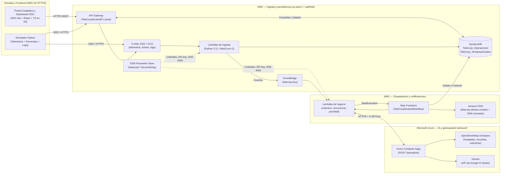

# Red TeleCorp Sentinel AI

Plataforma **serverless y multi-cloud (AWS + Microsoft Azure)** para detectar, priorizar y comunicar incidencias de red móvil en tiempo real. Cruza los reportes de los ciudadanos con la telemetría de las antenas, detecta fallas colectivas (≥ 10 usuarios distintos en < 24 h), se anticipa a ellas con IA (≥ 3 reportes + antena anómala), identifica antenas con fallas estructurales recurrentes y prioriza según la criticidad de la zona (hospitales, escuelas, industrias).

| Componente | Nube | Servicio |
| :--- | :--- | :--- |
| Ingesta, persistencia y API REST | AWS (`us-east-1`) | API Gateway, SQS + DLQ, Lambda (Python 3.11), DynamoDB, EventBridge, SSM Parameter Store |
| Orquestación y notificaciones | AWS (`us-east-1`) | Step Functions (`TeleCorpSentinelWorkflow`), Lambda, Amazon SNS |
| IA y análisis geoespacial | Azure (`westus2`) | Azure Container Apps (FastAPI) → Gemini (API de Google AI Studio) + OpenStreetMap Overpass |
| Frontend (Portal ciudadano + NOC) | AWS (`us-east-1`) | Amazon S3 Static Website (HTTPS) |

**URLs públicas**

- Portal ciudadano: https://telecorp-sentinel-portal-390577088044.s3.us-east-1.amazonaws.com/index.html
- Seguimiento: https://telecorp-sentinel-portal-390577088044.s3.us-east-1.amazonaws.com/index.html#/seguimiento
- Dashboard NOC: https://telecorp-sentinel-portal-390577088044.s3.us-east-1.amazonaws.com/index.html#/noc
- Servicio IA (Azure Container Apps): https://telecorp-ia.ambitiouspebble-a4a0a323.westus2.azurecontainerapps.io (`GET /health`, `POST /ia/analizar` con `X-API-Key`)
- API REST: `https://<API_ID>.execute-api.us-east-1.amazonaws.com/prod` (API `TeleCorpSentinelP1`)

**Equipo**

- **P1:** datos, ingesta y simulador (AWS).
- **P2:** orquestación y reglas de negocio (AWS).
- **P3:** IA multi-cloud, frontend y entregables (Azure + AWS).

---

## Índice

1. [Arquitectura](#1-arquitectura)
2. [Estructura del repositorio](#2-estructura-del-repositorio)
3. [Contratos compartidos](#3-contratos-compartidos)
4. [P1 — Ingesta, datos y API (`infra-datos/`)](#4-p1--ingesta-datos-y-api-infra-datos)
5. [P2 — Orquestación y reglas de negocio (`orquestacion/`)](#5-p2--orquestación-y-reglas-de-negocio-orquestacion)
6. [P3 — Servicio de IA en Azure (`ia-azure/`)](#6-p3--servicio-de-ia-en-azure-ia-azure)
7. [P3 — Frontend (`frontend/`)](#7-p3--frontend-frontend)
8. [Despliegue](#8-despliegue)
9. [Pruebas end-to-end de la demo](#9-pruebas-end-to-end-de-la-demo)
10. [Lecciones aprendidas](#10-lecciones-aprendidas)
11. [Documentación detallada](#11-documentación-detallada)

---

## 1. Arquitectura




**Decisión clave: el flujo entre nubes va de AWS a Azure.** La Lambda `enrich_and_score` llama a Azure Container Apps por HTTPS con la cabecera `X-API-Key`, cuyo valor está guardado en SSM Parameter Store. Así, el servicio de Azure nunca depende de las credenciales temporales de AWS Academy, que caducan cada 4 horas. Si Azure no responde, la Lambda usa un motor heurístico local (`FALLBACK_LOCAL`) y Step Functions no se interrumpe.

**Restricciones que se respetan**

- La solución es 100 % serverless, sin EC2 ni máquinas virtuales.
- Nunca hay más de 10 Lambdas simultáneas: los consumidores SQS usan `MaximumConcurrency=2` y API Gateway aplica *throttling*.
- No se usa Vercel.
- No hay secretos en el repositorio: los umbrales, la URL y la API key del servicio de IA y el ARN de SNS se leen de SSM.

---

## 2. Estructura del repositorio

```text
hackaton_cloud_computing/
├── README.md                     # Este documento
├── contratos/                    # Contratos congelados en la Fase 0
│   ├── dynamodb_schemas.json     # Tablas, GSI y TTL
│   ├── eventbridge_events.json   # Eventos del bus telecorp-bus
│   └── openapi.yaml              # Contrato REST (AWS + servicio de IA)
├── infra-datos/                  # [P1] Datos, ingesta, API y simulador
│   ├── setup_aws.sh              # DynamoDB, 3 SQS + DLQ, EventBridge y SSM
│   ├── deploy_p1.sh              # Despliegue de Lambdas P1 + API Gateway + smoke tests
│   ├── README_DESPLIEGUE_P1.md
│   ├── lambdas/                  # ingest_telemetry, ingest_ticket, ingest_logs, api_crud
│   └── simulator/storm_simulator.py
├── orquestacion/                 # [P2] Step Functions y reglas de negocio
│   ├── state_machine.asl.json    # TeleCorpSentinelWorkflow
│   ├── eventbridge_rules.json
│   ├── README_P2.md, DiagramaP2.png, TeleCorpSentinelWorkflow.png
│   └── lambdas/                  # eval_collective, eval_recurrence, enrich_and_score, notify_users
├── ia-azure/                     # [P3] Microservicio de IA + geoespacial (Azure Container Apps)
├── frontend/                     # [P3] SPA: Portal ciudadano, Seguimiento y NOC
└── docs/
    ├── arquitectura_telecorp.png
    ├── guion_pitch_4m40s.md
    ├── PENDIENTES_BACKEND.md     # Coordinación frontend ↔ backend
    └── secciones/                # Documentación extendida por módulo (ver §11)
```

---

## 3. Contratos compartidos

### 3.1 DynamoDB (`PAY_PER_REQUEST`)

**`TeleCorp_Operaciones`**: tiene la clave primaria `PK`/`SK`, el índice `GSI1_ZonaEstado` (`GSI1PK`/`GSI1SK`) y TTL en `ttl_epoch`.

| Entidad | `PK` | `SK` | `GSI1PK` | Atributos clave |
| :--- | :--- | :--- | :--- | :--- |
| Ticket | `TICKET#<id>` | `META` | `ZONA#<geohash>` | `user_id`, `lat`, `lon`, `geohash`, `problem_type`, `description`, `incident_time`, `status`, `master_incident_id`, `priority_score` |
| Historial | `TICKET#<id>` | `HIST#<ts>` | `USER#<user_id>` | `old_status`, `new_status`, `changed_by`, `note` |
| Antena | `ANTENNA#<id>` | `CURRENT` | `ZONA#<geohash>` | `last_traffic_gb`, `health_status`, `structural_risk` |
| Falla de antena | `ANTENNA#<id>` | `EVENT#<YYYY-MM-DD>#<ts>` | `FAILURES#ALL` | `health_status`, `traffic_gb`, `recovered_at`, `duration_sec` |
| Incidente maestro | `INCIDENT#<id>` | `META` | `ACTIVE#<bool>` | `trigger_type`, `affected_users_count`, `critical_pois`, `priority_score`, `priority_level`, `ai_diagnosis`, `ai_source`, `dispatch_mode`, `workflow_execution_id` |
| Log técnico | `LOG#<id>` | `META` | `LOG#<system>` | `level`, `message`, `ttl_epoch` (7 días) |

**`TeleCorp_VentanasZonales`**: tiene la clave primaria `PK`/`SK` y TTL en `expires_at`, que vale `now + 86400`.

| Registro | `PK` | `SK` | Uso |
| :--- | :--- | :--- | :--- |
| Usuario único | `WIN#<geohash>` | `USER#<user_id>` | Deduplicación dentro de la ventana de 24 h |
| Contador zonal | `WIN#<geohash>` | `COUNTER` | `unique_users_count` atómico y `active_incident_id` |
| Auditoría de notificación | `TICKET#<id>` | `NOTIF#<ts>#<CHANNEL>` | `EMAIL` (`SENT_SNS`) / `SMS` (`SIMULATED_SMS_ACADEMY`) |

### 3.2 Estados de antena y de ticket

- **Antena** (según `traffic_gb_min`): `INHABILITADA` (= 0), `CAIDA` (< 60), `NORMAL` (60–129) y `SATURADA` (> 129).
- **Ticket e incidente:** `Registrada` → `En revisión` → `Siendo atendida` → `Solucionada` → `Cerrada`.

### 3.3 Parámetros SSM (`SecureString`)

| Parámetro | Valor |
| :--- | :--- |
| `/telecorp/thresholds/min_gb` | `60` |
| `/telecorp/thresholds/max_gb` | `129` |
| `/telecorp/thresholds/collective_users` | `10` |
| `/telecorp/thresholds/window_hours` | `24` |
| `/telecorp/thresholds/recurrence_days` | `3` |
| `/telecorp/gcp/endpoint_url` *(nombre histórico, el servicio corre en Azure)* | URL de Azure Container Apps |
| `/telecorp/gcp/api_key` *(nombre histórico, el servicio corre en Azure)* | `<X_API_KEY>` |
| `/telecorp/sns/topic_arn` | ARN de `telecorp-alertas-zonales` |

### 3.4 Eventos de EventBridge (`telecorp-bus`)

| `DetailType` | `Source` | Emite | Consume |
| :--- | :--- | :--- | :--- |
| `incidencia.creada` | `telecorp.ingesta` | `ingest_ticket.py` | `eval_collective.py` |
| `antena.anomalia` | `telecorp.telemetria` | `ingest_telemetry.py` | `eval_collective.py`, `eval_recurrence.py` |
| `incidente.solucionado` | `telecorp.operaciones` | `api_crud.py` | `notify_users.py` |

### 3.5 API REST (API Gateway `TeleCorpSentinelP1`, stage `prod`)

| Método | Ruta | Descripción | Código |
| :--- | :--- | :--- | :--- |
| `POST` | `/tickets` | Crea un reporte ciudadano y lo encola en `telecorp-tickets-q` | `202` |
| `GET` | `/tickets` | Consulta por `ticket_id`, `user_id` o `geohash`, con `history` | `200` |
| `PATCH` | `/tickets/{ticket_id}/estado` | Cambia el estado y emite `incidente.solucionado` | `200` |
| `GET` | `/incidentes` | Incidentes maestros ordenados por `priority_score` | `200` |
| `PATCH` | `/incidentes/{incident_id}/estado` | Cambia el estado del incidente y de sus tickets en cascada | `200` |
| `GET` | `/antenas` | Estado, tráfico y `structural_risk` de cada antena | `200` |
| `POST` | `/telemetria` | Lectura de tráfico de una antena | `202` |
| `POST` | `/logs` | Log técnico (`INFO`–`CRITICAL`) | `202` |
| `GET` | `/analytics/resumen` | KPIs, `top_zones`, `recurrent_antennas`, `top_problem_types`, `master_incidents` | `200` |

El contrato completo está en [`contratos/openapi.yaml`](contratos/openapi.yaml), y el del servicio de IA, en la [§6](#6-p3--servicio-de-ia-en-azure-ia-azure).

---

## 4. P1 — Ingesta, datos y API (`infra-datos/`)

| Archivo | Función |
| :--- | :--- |
| `setup_aws.sh` | Valida la cuenta con STS y crea las tablas DynamoDB (GSI y TTL), las 3 colas SQS con sus DLQ (`maxReceiveCount=5`, retención de 14 días), el bus `telecorp-bus` y los parámetros SSM. |
| `deploy_p1.sh` | Modos `check`, `deploy` y `smoke`. Despliega las 4 Lambdas, los *event-source mappings* (`BatchSize=10`, `MaximumConcurrency=2`, `ReportBatchItemFailures`) y API Gateway (`burstLimit=2`, `rateLimit=3`). |
| `lambdas/ingest_telemetry.py` | Clasifica la antena con los umbrales de SSM, actualiza `ANTENNA#/CURRENT` y registra `EVENT#` diarios. Cierra `recovered_at` cuando la antena vuelve a `NORMAL` y publica `antena.anomalia` (si no es `NORMAL` o el tráfico cae > 35 %). |
| `lambdas/ingest_ticket.py` | Calcula el geohash de 6 caracteres en Python puro, guarda el ticket como `Registrada` junto con su `HIST#` inicial y publica `incidencia.creada`, deduplicando dentro del lote. |
| `lambdas/ingest_logs.py` | Normaliza los logs técnicos y les asigna un TTL de 7 días. |
| `lambdas/api_crud.py` | Capa REST completa (§3.5) detrás de API Gateway (`AWS_PROXY`), con CORS `*`. |
| `simulator/storm_simulator.py` | Modos `normal`, `storm-hospital`, `early-ai` y `recurrent`, con `--transport sqs` o `http` y concurrencia limitada (`max_workers=2`). |

Para el control de concurrencia, `ingest_ticket` e `ingest_telemetry` espacian 0,25 s sus publicaciones en EventBridge. Así `eval_collective` se mantiene en ≤ 1 ejecución concurrente.

---

## 5. P2 — Orquestación y reglas de negocio (`orquestacion/`)

| Archivo | Función |
| :--- | :--- |
| `eventbridge_rules.json` | Reglas `telecorp-collective-rule`, `telecorp-recurrence-rule` y `telecorp-incident-resolved-rule`. |
| `lambdas/eval_collective.py` | Deduplica usuarios en la ventana de 24 h (escritura condicional sobre `WIN#/USER#`) y actualiza el contador atómico. Dispara Step Functions en dos casos: `COLECTIVO_10` (≥ 10 usuarios distintos) y `TEMPRANO_IA` (≥ 3 usuarios con una antena anómala en el mismo geohash). Reserva `active_incident_id` para no duplicar incidentes. |
| `lambdas/eval_recurrence.py` | Cuenta los días calendario distintos con fallas en los últimos 7 días. Con ≥ 3 días marca `structural_risk = true` y devuelve `recent_failure_days`. |
| `lambdas/enrich_and_score.py` | Puente AWS → Azure: lee la URL y la key de SSM (caché de 60 s) y hace `POST /ia/analizar` (*timeout* de 8 s, 1 reintento, Lambda de 30 s para tolerar el *cold start*). Si falla, usa `FALLBACK_LOCAL`. Calcula la prioridad y persiste el incidente maestro. |
| `lambdas/notify_users.py` | Hace 1 publicación SNS consolidada por incidente e hito (`EN_EVALUACION`, `INCIDENCIA_IDENTIFICADA`, `SERVICIO_RESTABLECIDO`) y genera el SMS simulado (`ENABLE_DIRECT_SMS=false`). Registra la auditoría por ticket y canal y cierra en cascada al restablecerse el servicio. |
| `state_machine.asl.json` | Máquina `STANDARD`: `VerificarInfraestructuraYRecurrencia` → `AnalizarConIAYGeoespacialGCP` → `EvaluarCriticidad` (Choice) → `ConfirmarIncidenteZonal` (integración directa con DynamoDB) → `NotificarUsuariosAfectados`, con `Retry` y `Catch` en cada tarea. |

**Fórmula de prioridad**

```
Score = (usuarios_afectados × 10) × multiplicador_zona + bonus_antena + bonus_recurrencia
```

- **Bonus de antena:** +40 si está `CAIDA` o `INHABILITADA`, +25 si está `SATURADA`.
- **Bonus de recurrencia:** +35 si hay recurrencia estructural.
- **Niveles:** `CRITICA` ≥ 150, `ALTA` ≥ 80, `MEDIA` ≥ 40, `BAJA` < 40.

| Nivel | Enrutamiento en Step Functions |
| :--- | :--- |
| `CRITICA` | Atención inmediata (`Siendo atendida`, `INMEDIATO_CRITICO`) |
| `ALTA`, `MEDIA` o detección temprana | Revisión prioritaria (`En revisión`) |
| `BAJA` | Espera de 15 s para confirmar persistencia |

---

## 6. P3 — Servicio de IA en Azure (`ia-azure/`)

Es un microservicio **FastAPI** desplegado en **Azure Container Apps** (`westus2`, `min-replicas 0`, `max-replicas 3`, *scale-to-zero*). Por cada incidente combina dos análisis **en paralelo**:

- **Geoespacial:** consulta OpenStreetMap Overpass para encontrar puntos críticos en un radio de 500 m.
- **Semántico:** envía las descripciones a Gemini a través de la API de Google AI Studio.

### Archivos

| Archivo | Contenido |
| :--- | :--- |
| `main.py` | App FastAPI con `GET /health` y `POST /ia/analizar`. Valida `X-API-Key` en tiempo constante y valida la entrada con Pydantic (máx. 20 descripciones de 300 caracteres). Ejecuta el análisis geoespacial y el de IA con `asyncio.gather` y un presupuesto total de 5,5 s (el llamador corta a los 8 s). Si se excede, responde con los *fallbacks* en vez de devolver un 500. Calcula `structural_recurrence_alert` en código (≥ 3 días de falla), escribe logs JSON estructurados y tiene `MOCK_MODE` para demos sin servicios externos. |
| `geo_osm.py` | Consulta Overpass en un radio de 500 m (`hospital`, `clinic`, `doctors`, `school`, `university`, `landuse=industrial`) contra dos espejos con *timeout* de 2,5 s. Usa una caché en memoria por geohash (1 h) y un respaldo estático con POIs reales de Lima. Asigna el multiplicador más alto encontrado: hospital o clínica **3.0×**, escuela o universidad **2.2×**, industrial **2.0×**, residencial **1.0×**. |
| `gemini_engine.py` | Cliente `google-genai` con salida JSON estructurada (`response_schema`). Lanza en carrera los modelos de `GEMINI_MODELS` (por defecto `gemini-3.5-flash-lite,gemini-3.1-flash-lite`) y se queda con la primera respuesta válida, con *timeout* de 4 s. Normaliza la categoría, calcula la confianza del cluster semántico, decide `early_anomaly_detected` y redacta un diagnóstico ejecutivo. Ante cualquier error usa un *fallback* determinista por palabras clave. |
| `Dockerfile` | Imagen `python:3.11-slim` con usuario no-root que ejecuta `uvicorn` en `$PORT` (8080). |
| `requirements.txt` | `fastapi`, `uvicorn[standard]`, `httpx`, `google-genai`, `pydantic`. |
| `test_local.sh` | 3 casos con `curl`: sin key (401), Hospital Loayza (multiplicador 3.0 y anomalía temprana) y zona residencial (1.0). |
| `.env.example` | Variables `API_KEY`, `GEMINI_API_KEY`, `MOCK_MODE` y `GEMINI_MODELS`. |
| `DEPLOY.md` | Pasos reales de despliegue en Azure: build y push a GHCR, `az containerapp create` y pruebas. |

### Contrato `POST /ia/analizar`

**Request**

```json
{
  "geohash": "6mc5p8", "lat": -12.0464, "lon": -77.0428,
  "unique_users_count": 3,
  "descriptions": ["Internet muerto cerca al hospital", "Sin datos móviles desde hace una hora"],
  "antenna_id": "ANT-LIM-042", "antenna_traffic_gb": 61.5,
  "recent_failure_days": ["2026-11-10", "2026-11-12", "2026-11-14"]
}
```

**Response `200`**

```json
{
  "normalized_category": "CORTE_TOTAL_DATOS",
  "semantic_cluster_confidence": 0.94,
  "early_anomaly_detected": true,
  "critical_pois": [{ "name": "Hospital Nacional Arzobispo Loayza", "type": "hospital", "distance_m": 180 }],
  "zone_criticality_multiplier": 3.0,
  "structural_recurrence_alert": true,
  "ai_executive_diagnosis": "Degradación intermitente crónica en ANT-LIM-042 ..."
}
```

`normalized_category` toma uno de estos valores: `CORTE_TOTAL_DATOS`, `SIN_SENAL`, `INTERNET_LENTO`, `FALLA_LLAMADAS` u `OTRO`.

### Ejecutar en local

```bash
cd ia-azure
python -m venv .venv && source .venv/bin/activate
pip install -r requirements.txt
export API_KEY=<X_API_KEY> GEMINI_API_KEY=<GEMINI_API_KEY>   # o MOCK_MODE=true
uvicorn main:app --port 8080
# en otra terminal
API_KEY=<X_API_KEY> ./test_local.sh
```

---

## 7. P3 — Frontend (`frontend/`)

Es una SPA en **Vite + React 18 + TypeScript + Tailwind**. Usa `HashRouter` para funcionar en S3 sin reglas de *rewrite*, **TanStack Query** para el estado del servidor (*polling* cada 8 s), **React Hook Form + Zod** para los formularios, **Leaflet** para los mapas y **Recharts** para los gráficos.

### Rutas

| Ruta | Vista |
| :--- | :--- |
| `#/` | Portal ciudadano: asistente para reportar una incidencia con selección de ubicación en el mapa |
| `#/seguimiento` | Seguimiento por `ticket_id` o `user_id`, con la línea de tiempo de estados |
| `#/noc` | Resumen del NOC: KPIs, mapa de red, cola de incidentes y panel de riesgo |
| `#/noc/incidentes` | Incidentes maestros por prioridad, con detalle (POIs críticos, diagnóstico IA, cambio de estado) |
| `#/noc/antenas` | Antenas con su estado, tráfico y riesgo estructural |
| `#/noc/analitica` | Analítica histórica: MTTR, zonas y antenas con más fallas, tipos de problema |

### Archivos principales (`frontend/src/`)

| Ruta | Contenido |
| :--- | :--- |
| `main.tsx`, `App.tsx` | Punto de entrada, providers (Query, Toast) y definición de rutas. |
| `features/portal/` | `PortalLayout`, `HomePage`, `ReportWizard` (formulario por pasos), `LocationPicker` (mapa y geolocalización), `form.tsx` (esquemas Zod), `TicketSuccess` (código `TCK-...`), `TrackingPage` y `TicketTracker` (línea de tiempo). |
| `features/noc/` | `NocLayout`, `Sidebar`, `Topbar`, `OverviewPage`, `KpiRow`, `NetworkMap`, `IncidentQueue`, `IncidentsPage`, `IncidentDrawer` (detalle, diagnóstico de Gemini y botón para marcar `Solucionada`), `AntennasPage` y `AntennaCard`, `RiskPanel`, `AnalyticsPage` y `charts.tsx`, y `CommandPalette` (Ctrl/⌘ + K). |
| `components/ui/` | Componentes base: `Badge`, `Button`, `Card`, `Drawer`, `Skeleton`, `States` (vacío y error), `Tabs`, `Toast` y `Tooltip`. |
| `components/domain.tsx`, `Logo.tsx` | Badges de dominio (prioridad, estado, salud de antena) y logo. |
| `lib/api/` | `http.ts` (fetch con *timeout*, reintentos y `ApiError`), `index.ts` (cliente único del contrato, con respaldo a `/analytics/resumen` si `/incidentes` o `/antenas` responden 404) y `normalize.ts` (normaliza las respuestas del backend). |
| `lib/mock/` | `adapter.ts` y `seed.ts`: backend simulado en memoria que atiende las mismas rutas HTTP. Genera reportes e incidentes periódicos y puede simular errores. |
| `lib/config.ts` | Configuración pública a partir de las variables `VITE_*` y de los parámetros de URL (`?mock=`), además de la fuente de tiles del mapa (tiles propios, CARTO u OSM). |
| `lib/queries.ts`, `lib/hooks/` | Queries y mutaciones de TanStack Query y hooks compartidos. |
| `lib/geo.ts`, `format.ts`, `labels.ts`, `incident.ts`, `trend.ts` | Geohash y distancias, formato de fechas y números (`es-PE`, `America/Lima`), etiquetas legibles, utilidades de incidentes y tendencias. |
| `types/index.ts` | Tipos TypeScript del contrato (`Ticket`, `Incident`, `Antenna`, `Analytics`…). |

### Variables (`frontend/.env.example`)

| Variable | Uso |
| :--- | :--- |
| `VITE_API_BASE_URL` | URL del API Gateway, sin `/` final |
| `VITE_MOCK` | `true` usa el backend simulado; `false` usa el API real |
| `VITE_CARTO_API_KEY` | Opcional: mapas de CARTO (sin ella se usa OpenStreetMap) |
| `VITE_MAP_TILE_URL`, `VITE_MAP_ATTRIBUTION` | Opcional: tiles propios |

`npm run dev` usa el mock y `npm run build` usa `.env.production` (API real). En la URL, `?mock=1` o `?mock=0` fuerza el modo y `?mockerr=1` simula errores. Datos de demostración: ticket `TCK-DEMO01`, usuario `U-1001`.

```bash
cd frontend
npm install
npm run dev        # http://localhost:5173/#/
npm run lint && npm run typecheck
npm run build      # genera dist/
```

---

## 8. Despliegue

Para el despliegue se necesita:

- **AWS Academy** (cuenta `390577088044`, `us-east-1`, rol `LabRole`) desde CloudShell.
- **Azure for Students** (`westus2`).
- Una `GEMINI_API_KEY` de [Google AI Studio](https://aistudio.google.com/).

### 8.1 Servicio de IA en Azure

Los pasos completos están en [`ia-azure/DEPLOY.md`](ia-azure/DEPLOY.md). En resumen:

```bash
docker build -t ghcr.io/valdiviezojr/telecorp-ia:<tag> ia-azure
docker push ghcr.io/valdiviezojr/telecorp-ia:<tag>
az group create -n rg-telecorp -l eastus2
az containerapp env create -n telecorp-env -g rg-telecorp -l westus2 --logs-destination none
az containerapp create -n telecorp-ia -g rg-telecorp --environment telecorp-env \
  --image ghcr.io/valdiviezojr/telecorp-ia:<tag> --target-port 8080 --ingress external \
  --min-replicas 0 --max-replicas 3 \
  --secrets api-key=<X_API_KEY> gemini-key=<GEMINI_API_KEY> \
  --env-vars API_KEY=secretref:api-key GEMINI_API_KEY=secretref:gemini-key PORT=8080
```

Dos limitaciones de Azure for Students condicionan el despliegue:

- ACR Tasks no está disponible, por eso la imagen se construye en local y se sube a GHCR.
- La región `eastus2` está bloqueada por política para el entorno, por eso se usa `westus2`.

### 8.2 Backend AWS (P1 + P2)

```bash
export AWS_PAGER=""
export AWS_DEFAULT_REGION=us-east-1
export TELECORP_ACCOUNT_ID=390577088044
export GCP_ENDPOINT_URL="https://telecorp-ia.ambitiouspebble-a4a0a323.westus2.azurecontainerapps.io"  # nombre histórico
export GCP_API_KEY="<X_API_KEY>"                                                                      # nombre histórico

# Opción A: todo de forma idempotente (P1 + SNS/SSM + P2 + Step Functions + frontend)
bash ~/deploy_all.sh

# Opción B: solo P1
P1_PUBLIC_DEMO=true bash infra-datos/deploy_p1.sh deploy
bash infra-datos/deploy_p1.sh smoke
```

Los comandos para desplegar cada Lambda de P2, las reglas de EventBridge y la máquina de estados están en [`orquestacion/README_P2.md`](orquestacion/README_P2.md). Recuerda confirmar la suscripción SNS en el correo que llega desde `no-reply@sns.amazonaws.com`.

### 8.3 Frontend en S3

```bash
API_ID=$(aws apigateway get-rest-apis --query "items[?name=='TeleCorpSentinelP1'].id | [0]" --output text)
cd frontend
printf 'VITE_API_BASE_URL=https://%s.execute-api.us-east-1.amazonaws.com/prod\nVITE_MOCK=false\n' "$API_ID" > .env.production
npm install && npm run build
aws s3 sync dist/ "s3://telecorp-sentinel-portal-390577088044/" --delete
```

Se sirve desde la URL HTTPS regional de S3, porque CloudFront está bloqueado por IAM en AWS Academy.

---

## 9. Pruebas end-to-end de la demo

| Prueba | Comando | Resultado esperado |
| :--- | :--- | :--- |
| **A. Tormenta hospital vs. residencial** | `python3 infra-datos/simulator/storm_simulator.py --mode storm-hospital --transport sqs` | 0 mensajes en las DLQ y 15 usuarios únicos por zona. Se lanzan 2 ejecuciones de Step Functions en `SUCCEEDED`: la zona del hospital sale `CRITICA` (3.0×) y la residencial de menor prioridad. Llega el correo SNS. Al marcar `Solucionada` en el NOC llega el correo "Servicio restablecido". |
| **B. Detección temprana con IA** | `... --mode early-ai --transport sqs` | Con solo 3 usuarios y la antena caída se dispara `TEMPRANO_IA`, y Gemini confirma `early_anomaly_detected: true`. |
| **C. Falla estructural recurrente** | `... --mode recurrent --transport sqs` | `ANT-REC-09` queda con `structural_risk = true`, el diagnóstico IA recomienda mantenimiento y el NOC muestra "RIESGO ESTRUCTURAL". |

Para verificar la concurrencia, mira `AWS/Lambda → ConcurrentExecutions` en CloudWatch: el pico debe ser ≤ 10.

---

## 10. Lecciones aprendidas

- Ejecuta `export AWS_PAGER=""` en CloudShell y replica en Git cualquier parche que hagas allí.
- En los redespliegues usa `update-function-code` y `update-state-machine`; los comandos `create-*` fallan si el recurso ya existe.
- Antes de cambiar la salida de una Lambda orquestada, revisa las rutas JSONPath de `state_machine.asl.json`.
- Antes de repetir una prueba en la misma celda, limpia `WIN#<geohash>/COUNTER`.
- Las coordenadas `(-12.0464, -77.0428)` producen el geohash real `6mc5qz`. Los geohashes del simulador son: hospital `6mc5qy`, residencial `6mc5nq`, temprano `6mc4zr` y recurrente `6mc4zb`.
- Las credenciales de AWS Academy se renuevan cada 4 h; los recursos no se borran.
- En Azure Container Apps, sube `--min-replicas 1` antes de la demo para evitar el *cold start*.

---

## 11. Documentación detallada

- [`docs/secciones/plan_de_guerra_red_telecorp.md`](docs/secciones/plan_de_guerra_red_telecorp.md): plan de 24 h, tareas por persona, cronograma y checklist de la rúbrica.
- [`docs/secciones/README_DESPLIEGUE_P1.md`](docs/secciones/README_DESPLIEGUE_P1.md): despliegue del módulo P1.
- [`docs/secciones/README_P2.md`](docs/secciones/README_P2.md): módulo P2 con comandos de despliegue y validación.
- [`docs/secciones/legado_de_despliegue_red_telecorp_sentinel.md`](docs/secciones/legado_de_despliegue_red_telecorp_sentinel.md): inventario de recursos desplegados, parches aplicados y mantenimiento.
- [`ia-azure/DEPLOY.md`](ia-azure/DEPLOY.md): despliegue del servicio de IA en Azure.
- [`frontend/README_FRONTEND.md`](frontend/README_FRONTEND.md): guía rápida del frontend.
- [`docs/PENDIENTES_BACKEND.md`](docs/PENDIENTES_BACKEND.md): coordinación frontend ↔ backend.
- [`docs/guion_pitch_4m40s.md`](docs/guion_pitch_4m40s.md): guion del video pitch.
