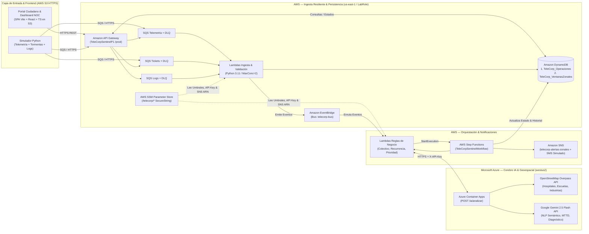

# PLAN DE GUERRA — RED TELECORP (`SENTINEL AI`)

> **Objetivo:** 20/20 puntos en la rúbrica · **Tiempo:** 24 horas · **Equipo:** 3 personas (`P1`, `P2`, `P3`)  
> **Restricciones Críticas:** 100% Serverless · AWS Academy (`us-east-1`, cuenta `390577088044`, `LabRole`, Amazon SNS, SSM Parameter Store, techo operativo $\le 10$ Lambdas simultáneas) + Microsoft Azure (`westus2`, Azure Container Apps + Gemini API + OpenStreetMap Overpass) · Hosting en AWS S3 Static Website HTTPS (Prohibido Vercel, prohibido adjuntar informe escrito, video máximo `04:45` min).

---

## 1. Arquitectura Unificada y Estructura del Monorepo

### Diagrama de Flujo Multi-Cloud (AWS + Azure)



### Decisión Arquitectónica Clave (Inmunidad a Caducidad de 4h de AWS Academy)
El flujo inter-cloud es **AWS $\rightarrow$ Azure** (AWS Lambda invoca a **Azure Container Apps** mediante `HTTPS` con cabecera `X-API-Key` almacenada en **AWS SSM Parameter Store**). De este modo, el microservicio de IA en Azure nunca depende de credenciales temporales STS de AWS Academy que caducan cada 4 horas.

### Estructura del Monorepo (`hackaton_cloud_computing`)

```text
hackaton_cloud_computing/
├── README.md                      # Documentación técnica completa (reemplaza cualquier informe PDF)
├── PLAN_DE_GUERRA.md              # Este documento operativo
├── contratos/
│   ├── dynamodb_schemas.json      # Definición de tablas, GSIs y TTL
│   ├── eventbridge_events.json    # Ejemplos reales de eventos del bus telecorp-bus
│   └── openapi.yaml               # Contrato REST unificado (AWS + Azure)
├── infra-datos/                   # [P1] AWS Datos, Ingesta, API y Simulador
│   ├── setup_aws.sh               # Script CLI para DynamoDB, 3 SQS+DLQ, EventBridge y SSM
│   ├── deploy_p1.sh               # Despliegue automatizado de Lambdas P1, API Gateway y smoke tests
│   ├── lambdas/
│   │   ├── ingest_telemetry.py    # Evalúa umbrales (0, <60, 60-129, >129 GB/min) y eventos EVENT#
│   │   ├── ingest_ticket.py       # Crea ticket, geohash (6 chars) y emite incidencia.creada
│   │   ├── ingest_logs.py         # Normaliza logs internos con TTL de 7 días
│   │   └── api_crud.py            # POST/GET/PATCH tickets, /telemetria, /logs y /analytics/resumen
│   └── simulator/
│       └── storm_simulator.py     # Generador de telemetría normal, tormentas y recurrencia
├── orquestacion/                  # [P2] AWS Step Functions y Reglas de Negocio
│   ├── state_machine.asl.json     # Definición exacta de AWS Step Functions (TeleCorpSentinelWorkflow)
│   ├── eventbridge_rules.json    # Reglas de enrutamiento de telecorp-bus
│   └── lambdas/
│       ├── eval_collective.py     # Deduplicación >=10 usuarios únicos en <24h y disparo SFN
│       ├── eval_recurrence.py     # Detección de fallas estructurales multi-día (>=3 días)
│       ├── enrich_and_score.py    # Llama a Azure Container Apps /ia/analizar y calcula score
│       └── notify_users.py        # Envío Amazon SNS (Email) + registro SMS simulado + auditoría
├── ia-azure/                      # [P3] Microservicio IA + Geoespacial en Azure Container Apps
│   ├── main.py                    # FastAPI con endpoint POST /ia/analizar y GET /health
│   ├── geo_osm.py                 # Consulta radio 500m en Overpass API (hospitales/escuelas)
│   ├── gemini_engine.py           # Clasificación NLP, cluster temprano y diagnóstico estructural
│   ├── Dockerfile                 # Imagen ligera para Azure Container Apps (scale-to-zero)
│   └── requirements.txt
├── frontend/                      # [P3] Portal Ciudadano y Centro de Operaciones (NOC)
│   ├── package.json               # SPA Vite + React 18 + TypeScript + Tailwind + HashRouter
│   ├── index.html                 # Punto de entrada SPA desplegado en Amazon S3 HTTPS
│   └── src/                       # Vistas: Portal Ciudadano (/), Seguimiento (#/seguimiento), NOC (#/noc)
└── docs/                          # [P3] Entregables Visuales
    ├── arquitectura_telecorp.png  # Diagrama exportado en alta resolución para Canvas
    └── guion_pitch_4m40s.md       # Guion cronometrado segundo a segundo
```

---

## 2. Setup Crítico de Supervivencia (Primeros 20 Minutos)

Ejecutar esta lista **entre los 3 integrantes** antes de escribir una sola línea de lógica de negocio:

### A. Configuración en AWS Academy (`us-east-1`, Cuenta `390577088044`)
1. **Iniciar Learner Lab** y abrir **AWS CloudShell** (desactivando el paginador para evitar bloqueos).
2. **Verificar cuenta, región y obtener ARN de `LabRole`** (obligatorio para todas las Lambdas y Step Functions):
   ```bash
   export AWS_PAGER=""
   export AWS_DEFAULT_REGION=us-east-1
   export TELECORP_ACCOUNT_ID=$(aws sts get-caller-identity --query 'Account' --output text)
   aws iam get-role --role-name LabRole --query 'Role.Arn' --output text
   # ARN esperado: arn:aws:iam::390577088044:role/LabRole
   ```
3. **Crear tópico en Amazon SNS y suscribir correos del equipo** (sin confirmar el enlace, SNS no enviará alertas):
   ```bash
   export SNS_TOPIC_ARN=$(aws sns create-topic --name telecorp-alertas-zonales --query 'TopicArn' --output text)
   aws sns subscribe --topic-arn "$SNS_TOPIC_ARN" --protocol email --notification-endpoint correo_p1@dominio.com
   aws sns subscribe --topic-arn "$SNS_TOPIC_ARN" --protocol email --notification-endpoint correo_p2@dominio.com
   aws sns subscribe --topic-arn "$SNS_TOPIC_ARN" --protocol email --notification-endpoint correo_p3@dominio.com
   # CADA INTEGRANTE debe abrir su bandeja y confirmar el correo de no-reply@sns.amazonaws.com ahora mismo.
   ```
4. **Cargar Variables Globales Seguras en AWS SSM Parameter Store (`SecureString`)**:
   ```bash
   aws ssm put-parameter --name "/telecorp/thresholds/min_gb" --value "60" --type "SecureString" --overwrite
   aws ssm put-parameter --name "/telecorp/thresholds/max_gb" --value "129" --type "SecureString" --overwrite
   aws ssm put-parameter --name "/telecorp/thresholds/collective_users" --value "10" --type "SecureString" --overwrite
   aws ssm put-parameter --name "/telecorp/thresholds/window_hours" --value "24" --type "SecureString" --overwrite
   aws ssm put-parameter --name "/telecorp/thresholds/recurrence_days" --value "3" --type "SecureString" --overwrite
   aws ssm put-parameter --name "/telecorp/gcp/api_key" --value "<X_API_KEY>" --type "SecureString" --overwrite
   aws ssm put-parameter --name "/telecorp/gcp/endpoint_url" --value "https://telecorp-ia.ambitiouspebble-a4a0a323.westus2.azurecontainerapps.io" --type "SecureString" --overwrite
   aws ssm put-parameter --name "/telecorp/sns/topic_arn" --value "$SNS_TOPIC_ARN" --type "SecureString" --overwrite
   ```
   *(Nota: se conservan los nombres `/telecorp/gcp/endpoint_url` y `/telecorp/gcp/api_key` para apuntar al contenedor de Azure Container Apps sin acoplar código).*
5. **Protocolo de Renovación de Credenciales cada 4 Horas:**
   * Cuando el punto verde del Learner Lab se apague, hacer clic en **Start Lab** $\rightarrow$ **AWS Details** $\rightarrow$ **Show** (AWS CLI).
   * Pegar el bloque `[default]` en `~/.aws/credentials` y ejecutar:
     ```bash
     aws sts get-caller-identity
     ```
   * **Nota:** Los recursos desplegados en AWS (DynamoDB, Lambdas, Step Functions, S3, SSM, SNS) **NO se borran** al reiniciar las 4 horas; solo se renueva tu sesión CLI/Consola.

### B. Configuración en Microsoft Azure (`westus2`) y Google AI Studio
1. **P3** ingresa a [Google AI Studio](https://aistudio.google.com/) y genera una `GEMINI_API_KEY` gratuita.
2. **P3** ingresa a [Azure Portal](https://portal.azure.com/), crea un grupo de recursos y despliega el contenedor en **Azure Container Apps** (`westus2`) con escalado a cero (`min-replicas 0`, `max-replicas 3`) y variables de entorno `GEMINI_API_KEY` y `API_KEY`.
3. Publica la URL HTTPS (`https://telecorp-ia.ambitiouspebble-a4a0a323.westus2.azurecontainerapps.io`) en el chat del equipo para almacenarla en SSM `/telecorp/gcp/endpoint_url`.

---

## 3. Fase 0 — Contratos Compartidos (Hora 00:00 a 01:30, los 3 juntos)

Ningún integrante avanza a programar sin congelar estos 4 contratos:

### 3.1 Esquema de Tablas DynamoDB (`us-east-1`, Billing Mode: `PAY_PER_REQUEST`)

#### Tabla 1: `TeleCorp_Operaciones`
Almacena tickets individuales, incidentes maestros zonales, lecturas de antenas, logs e historial de auditoría.
* **Clave Primaria:** `PK` (String), `SK` (String)
* **GSI-1 (`GSI1_ZonaEstado`):** `GSI1PK` (String), `GSI1SK` (String) — para consultar incidencias activas por zona o historial por usuario.
* **TTL Attribute:** `ttl_epoch` (Number, retención de 7 días para logs crudos).

| Entidad | `PK` | `SK` | `GSI1PK` | `GSI1SK` | Atributos Clave |
| :--- | :--- | :--- | :--- | :--- | :--- |
| **Ticket Usuario** | `TICKET#<ticket_id>` | `META` | `ZONA#<geohash>` | `TS#<iso_ts>` | `user_id`, `service_number`, `email`, `phone`, `location_text`, `lat`, `lon`, `geohash`, `problem_type`, `description`, `incident_time`, `ai_category`, `status` (`Registrada`\|`En revisión`\|`Siendo atendida`\|`Solucionada`\|`Cerrada`), `master_incident_id`, `priority_score`, `priority_level` |
| **Historial Auditoría** | `TICKET#<ticket_id>` | `HIST#<iso_ts>` | `USER#<user_id>` | `TS#<iso_ts>` | `old_status`, `new_status`, `changed_by` (`SISTEMA_SFN`\|`OPERADOR`), `note` |
| **Estado Antena** | `ANTENNA#<antenna_id>` | `CURRENT` | `ZONA#<geohash>` | `ANTENNA#<antenna_id>` | `zone_name`, `lat`, `lon`, `geohash`, `last_traffic_gb`, `health_status` (`INHABILITADA`\|`CAIDA`\|`NORMAL`\|`SATURADA`), `updated_at`, `structural_risk` (Boolean) |
| **Historial Falla Antena** | `ANTENNA#<antenna_id>` | `EVENT#<YYYY-MM-DD>#<iso_ts>` | `FAILURES#ALL` | `TS#<iso_ts>` | `date_day`, `health_status`, `traffic_gb`, `recovered_at`, `duration_sec` |
| **Incidente Maestro** | `INCIDENT#<incident_id>` | `META` | `ACTIVE#<is_active>` | `SCORE#<00000>` | `geohash`, `zone_name`, `trigger_type` (`COLECTIVO_10`\|`TEMPRANO_IA`), `affected_users_count`, `critical_pois` (lista hospitales/escuelas), `priority_score`, `priority_level`, `status`, `ai_diagnosis`, `ai_source`, `dispatch_mode`, `workflow_execution_id`, `created_at`, `closed_at` |
| **Log Técnico** | `LOG#<log_id>` | `META` | `LOG#<system>` | `TS#<iso_ts>` | `system`, `antenna_id`, `geohash`, `level`, `message`, `ttl_epoch` |

#### Tabla 2: `TeleCorp_VentanasZonales`
Controla la ventana móvil de $< 24\text{ horas}$, la deduplicación estricta de usuarios únicos por zona y la auditoría omnicanal de notificaciones.
* **Clave Primaria:** `PK` (String), `SK` (String)
* **TTL Attribute:** `expires_at` (Number — Epoch UNIX `now + 86400` segundos = 24h exactas).

| Registro | `PK` | `SK` | Atributos Clave |
| :--- | :--- | :--- | :--- |
| **Usuario Único en Ventana** | `WIN#<geohash>` | `USER#<user_id>` | `first_ticket_id`, `problem_type`, `description`, `expires_at` (DynamoDB borra el registro automáticamente a las 24h) |
| **Contador Atómico Zonal** | `WIN#<geohash>` | `COUNTER` | `unique_users_count` (Number, actualizado atómicamente solo si `USER#<user_id>` no existía), `active_incident_id`, `expires_at` |
| **Auditoría Notificación** | `TICKET#<ticket_id>` | `NOTIF#<iso_ts>#<CHANNEL>` | `GSI1PK=INCIDENT#<incident_id>`, `milestone`, `channel` (`EMAIL`\|`SMS`), `delivery_status` (`SENT_SNS`\|`SIMULATED_SMS_ACADEMY`), `recipient` |

---

### 3.2 Rutas Exactas de AWS SSM Parameter Store
* `/telecorp/thresholds/min_gb` $\rightarrow$ `"60"`
* `/telecorp/thresholds/max_gb` $\rightarrow$ `"129"`
* `/telecorp/thresholds/collective_users` $\rightarrow$ `"10"`
* `/telecorp/thresholds/window_hours` $\rightarrow$ `"24"`
* `/telecorp/thresholds/recurrence_days` $\rightarrow$ `"3"`
* `/telecorp/gcp/endpoint_url` $\rightarrow$ `"https://telecorp-ia.ambitiouspebble-a4a0a323.westus2.azurecontainerapps.io"`
* `/telecorp/gcp/api_key` $\rightarrow$ `"<X_API_KEY>"`
* `/telecorp/sns/topic_arn` $\rightarrow$ `"arn:aws:sns:us-east-1:390577088044:telecorp-alertas-zonales"`

---

### 3.3 Payloads JSON de Amazon EventBridge (Bus: `telecorp-bus`)

#### Evento 1: `incidencia.creada` (Emite P1 `ingest_ticket.py` $\rightarrow$ Consume P2 `eval_collective.py`)
```json
{
  "Source": "telecorp.ingesta",
  "DetailType": "incidencia.creada",
  "Detail": {
    "ticket_id": "TCK-98231",
    "user_id": "DNI-70451289",
    "service_number": "999111222",
    "email": "usuario@dominio.com",
    "phone": "+51999111222",
    "geohash": "6mc5qy",
    "lat": -12.0498,
    "lon": -77.0428,
    "problem_type": "SIN_INTERNET",
    "description": "No carga nada desde hace 20 minutos frente al Hospital Loayza",
    "incident_time": "2026-11-15T16:10:00Z",
    "timestamp": "2026-11-15T16:10:00Z"
  }
}
```

#### Evento 2: `antena.anomalia` (Emite P1 `ingest_telemetry.py` $\rightarrow$ Consume P2 `eval_collective.py` y `eval_recurrence.py`)
```json
{
  "Source": "telecorp.telemetria",
  "DetailType": "antena.anomalia",
  "Detail": {
    "antenna_id": "ANT-HOSP-01",
    "geohash": "6mc5qy",
    "lat": -12.0498,
    "lon": -77.0428,
    "traffic_gb_min": 42.5,
    "previous_traffic_gb": 105.0,
    "health_status": "CAIDA",
    "timestamp": "2026-11-15T16:10:05Z"
  }
}
```

#### Evento 3: `incidente.solucionado` (Emite P1 `api_crud.py` $\rightarrow$ Consume P2 `notify_users.py`)
```json
{
  "Source": "telecorp.operaciones",
  "DetailType": "incidente.solucionado",
  "Detail": {
    "incident_id": "INC-20261115-001",
    "ticket_id": "TCK-98231",
    "geohash": "6mc5qy",
    "new_status": "Solucionada",
    "changed_by": "OPERADOR",
    "note": "Enlace de fibra restablecido en ANT-HOSP-01",
    "timestamp": "2026-11-15T17:05:00Z"
  }
}
```

---

### 3.4 Contrato REST (`openapi.yaml` resumido)

#### Endpoints AWS API Gateway (`TeleCorpSentinelP1`, Construye P1, Consume P3 Frontend)
* `POST /tickets` — Crea reporte ciudadano (encola en `telecorp-tickets-q`).
  * **Body:** `{ "user_id", "service_number", "email", "phone", "location_text", "lat", "lon", "problem_type", "description", "incident_time" }`
  * **Response `202`:** `{ "ticket_id": "TCK-98231", "status": "Registrada", "geohash": "6mc5qy" }`
* `GET /tickets?ticket_id=...&user_id=...&geohash=...` — Lista incidencias con su historial de estados (`history`).
* `PATCH /tickets/{ticket_id}/estado` — Actualiza estado (`Registrada`, `En revisión`, `Siendo atendida`, `Solucionada`, `Cerrada`) y dispara evento `incidente.solucionado` si pasa a `Solucionada`.
* `POST /telemetria` — Ingiere métrica de antena `{ "antenna_id", "lat", "lon", "traffic_gb_min", "timestamp" }` hacia `telecorp-telemetry-q`.
* `POST /logs` — Ingiere log interno `{ "system", "antenna_id", "geohash", "level", "message", "timestamp" }` hacia `telecorp-logs-q`.
* `GET /analytics/resumen` — Devuelve KPIs históricos (`total_tickets`, `active_incidents`, `avg_mttr_minutes`, `total_affected_users`), `top_zones`, `recurrent_antennas`, `top_problem_types` y `master_incidents` (usado también por el Frontend NOC para poblar incidentes y antenas en tiempo real).

#### Endpoint Azure Container Apps (Construye P3, Consume P2 Lambda)
* `POST /ia/analizar` (Header obligatorio: `X-API-Key: <X_API_KEY>`)
  * **Request Body:**
    ```json
    {
      "geohash": "6mc5qy",
      "lat": -12.0498,
      "lon": -77.0428,
      "unique_users_count": 3,
      "descriptions": ["Internet muerto cerca al hospital", "Sin datos móviles"],
      "antenna_id": "ANT-HOSP-01",
      "antenna_traffic_gb": 42.5,
      "recent_failure_days": ["2026-11-10", "2026-11-12", "2026-11-14"]
    }
    ```
  * **Response `200`:**
    ```json
    {
      "normalized_category": "CORTE_TOTAL_DATOS",
      "semantic_cluster_confidence": 0.94,
      "early_anomaly_detected": true,
      "critical_pois": [
        {"name": "Hospital Nacional Arzobispo Loayza", "type": "hospital", "distance_m": 180}
      ],
      "zone_criticality_multiplier": 3.0,
      "structural_recurrence_alert": true,
      "ai_executive_diagnosis": "Degradación intermitente crónica en ANT-HOSP-01 (3 días distintos) con impacto directo en infraestructura hospitalaria a 180m. Se recomienda inspección de hardware/energía."
    }
    ```

---

## 4. Guía Paso a Paso por Persona (Ordenada por Dependencias)

### P1 — Ingeniero de Datos, Ingesta y Simulador (AWS)

#### Tarea P1.1: Creación de Tablas DynamoDB, 3 Colas SQS + DLQ y Bus EventBridge
* **Qué hacer y cómo implementarlo:** Ejecutar `infra-datos/setup_aws.sh` usando AWS CLI en `us-east-1` (cuenta `390577088044`) para crear las tablas `TeleCorp_Operaciones` (con `GSI1_ZonaEstado`) y `TeleCorp_VentanasZonales` (habilitando TTL en `expires_at`), tres colas SQS estándar (`telecorp-telemetry-q`, `telecorp-tickets-q` y `telecorp-logs-q`) cada una con su Dead-Letter Queue (`-dlq`), y el bus de eventos `telecorp-bus`. Blindar los *event-source mappings* SQS con `BatchSize=10` y `MaximumConcurrency=2` para respetar los límites de AWS Academy.
* **Para qué sirve en el negocio:** Garantiza persistencia multi-AZ de alta disponibilidad (2 pts) y absorción elástica sin pérdida de datos ni desbordamiento de concurrencia durante tormentas o apagones masivos (3 pts).
* **Por qué es vital para tu compañero (Dependencia):** Desbloquea a **P2** para que pueda suscribir reglas de EventBridge y leer/escribir estados en DynamoDB.
* **Criterio de terminado (Definition of Done):** Ejecutar `aws dynamodb list-tables`, `aws sqs list-queues` y `aws events list-event-buses` confirmando que todos los recursos están `ACTIVE`.

#### Tarea P1.2: Lambda de Ingesta de Telemetría y Evaluación de Umbrales (`ingest_telemetry.py`)
* **Qué hacer y cómo implementarlo:** Crear función Lambda Python 3.11 con rol `LabRole` disparada por `telecorp-telemetry-q` (`BatchSize=10`, `ReportBatchItemFailures`). Debe leer `/telecorp/thresholds/min_gb` (`60`) y `max_gb` (`129`) desde SSM Parameter Store (con caché en memoria global), evaluar `traffic_gb_min`: $= 0 \rightarrow$ `INHABILITADA`; $0 < x < 60 \rightarrow$ `CAIDA`; $60 \le x \le 129 \rightarrow$ `NORMAL`; $> 129 \rightarrow$ `SATURADA`. Guardar en `TeleCorp_Operaciones` (`ANTENNA#<id>`, `SK=CURRENT`), registrar eventos diarios `EVENT#<YYYY-MM-DD>#<iso_ts>` (cerrando `recovered_at` y `duration_sec` al volver a `NORMAL`) y, si el estado no es `NORMAL` (o cayó $> 35\%$ respecto a la lectura previa), publicar `antena.anomalia` en `telecorp-bus`.
* **Para qué sirve en el negocio:** Implementa las reglas exactas de clasificación de antenas y alimenta la detección temprana y de recurrencia estructural (3 pts).
* **Por qué es vital para tu compañero (Dependencia):** Alimenta a **P2** con los eventos `antena.anomalia` e historial `EVENT#` necesarios para correlacionar infraestructura con reportes de usuarios.
* **Criterio de terminado (Definition of Done):** Enviar mensajes de prueba a `telecorp-telemetry-q` con valores `0`, `45`, `90` y `140` y verificar en DynamoDB los 4 estados exactos (`INHABILITADA`, `CAIDA`, `NORMAL`, `SATURADA`).

#### Tarea P1.3: Lambdas de Ingesta de Tickets (`ingest_ticket.py`) y Logs (`ingest_logs.py`)
* **Qué hacer y cómo implementarlo:** Crear `telecorp-ingest-ticket` conectada a `telecorp-tickets-q` y `telecorp-ingest-logs` conectada a `telecorp-logs-q` con rol `LabRole`. `ingest_ticket.py` calcula el `geohash` de precisión 6 a partir de `(lat, lon)` (función pura en Python), guarda el ticket en `TeleCorp_Operaciones` con estado inicial `Registrada` + primer registro de auditoría `HIST#<ts>`, y publica el evento `incidencia.creada` en `telecorp-bus`. `ingest_logs.py` almacena logs técnicos (`INFO`, `WARN`, `ERROR`, `CRITICAL`) con `ttl_epoch` de 7 días.
* **Para qué sirve en el negocio:** Permite capturar ubicación aproximada, agrupar dinámicamente por sector geográfico de 6 caracteres sin depender de distritos fijos y conservar historial inmutable (3 pts).
* **Por qué es vital para tu compañero (Dependencia):** Desbloquea el flujo principal de **P2** (`eval_collective.py`) y entrega datos reales al dashboard de **P3**.
* **Criterio de terminado (Definition of Done):** Inyectar un JSON de ticket en SQS y verificar que aparezca en DynamoDB con `status="Registrada"`, su `HIST#` inicial y el evento publicado en EventBridge.

#### Tarea P1.4: API Gateway REST y Endpoints de Consulta/Actualización (`api_crud.py`)
* **Qué hacer y cómo implementarlo:** Desplegar API Gateway REST (`TeleCorpSentinelP1`, stage `prod` con *throttling* `burstLimit=2, rateLimit=3`) con CORS habilitado (`*`) y `authorization-type NONE` (`P1_PUBLIC_DEMO=true`) conectado a `telecorp-api-crud`:
  * `POST /tickets`, `POST /telemetria` y `POST /logs` encolando en sus respectivas colas SQS (`202 Accepted`).
  * `GET /tickets` (consulta por `ticket_id`, `user_id` o `geohash` incluyendo arreglo `history`).
  * `PATCH /tickets/{ticket_id}/estado` (valida catálogo estricto de los 5 estados, graba auditoría `HIST#<ts>` y si cambia a `Solucionada` emite evento `incidente.solucionado` a `telecorp-bus`).
  * `GET /analytics/resumen` (agrega KPIs globales, `top_zones`, `recurrent_antennas`, `top_problem_types` y `master_incidents`).
* **Para qué sirve en el negocio:** Materializa el portal ciudadano, la administración de incidencias y la analítica operativa/histórica requerida por el caso (3 pts).
* **Por qué es vital para tu compañero (Dependencia):** Es la interfaz única que **P3** consumirá desde el Frontend SPA en S3.
* **Criterio de terminado (Definition of Done):** Ejecutar `bash infra-datos/deploy_p1.sh smoke` y comprobar respuestas `HTTP 200/202/400` y cabeceras `Access-Control-Allow-Origin: *`.

#### Tarea P1.5: Simulador de Telemetría, Tormentas y Recurrencia (`infra-datos/simulator/storm_simulator.py`)
* **Qué hacer y cómo implementarlo:** Script Python ejecutable desde terminal con 4 modos por CLI (`--transport sqs` o `http`): `--mode normal` (tráfico entre 70–115 GB/min), `--mode storm-hospital` (dispara caída de antena `42 GB/min` + 15 reportes en zona hospitalaria `6mc5qy` y 15 en zona residencial `6mc5nq`), `--mode early-ai` (envía 3 reportes semánticos + caída en `6mc4zr`), y `--mode recurrent` (siembra fallas de `ANT-REC-09` en 4 días distintos en `6mc4zb`).
* **Para qué sirve en el negocio:** Demuestra en vivo la resiliencia ante avalanchas de eventos simultáneos y permite ejecutar la demo del pitch en segundos.
* **Por qué es vital para tu compañero (Dependencia):** Permite a **P2** y **P3** validar la integración completa sin crear datos manualmente.
* **Criterio de terminado (Definition of Done):** Ejecutar `python3 infra-datos/simulator/storm_simulator.py --mode storm-hospital --transport sqs` y verificar que los 34 mensajes ingresen a SQS sin errores.

---

### P2 — Arquitecto de Orquestación y Lógica de Negocio (AWS)

#### Tarea P2.1: Reglas de EventBridge y Motor de Detección Colectiva (`eval_collective.py`)
* **Qué hacer y cómo implementarlo:** Crear regla `telecorp-collective-rule` en `telecorp-bus` que enrute `incidencia.creada` y `antena.anomalia` a `telecorp-eval-collective` (`LabRole`). Esta Lambda implementa la lógica clave en `TeleCorp_VentanasZonales`:
  1. Intenta insertar `PK=WIN#<geohash>`, `SK=USER#<user_id>` con `ConditionExpression="attribute_not_exists(PK) OR expires_at <= :now"` y `expires_at = now + 86400`.
  2. **Solo si es un usuario nuevo en la ventana de 24h**, ejecuta `UpdateItem` atómico (`ADD unique_users_count :inc`) sobre `SK=COUNTER`.
  3. Lee `/telecorp/thresholds/collective_users` (`10`) desde SSM. Si `unique_users_count == 10` (`COLECTIVO_10`) o si `unique_users_count >= 3` Y existe una antena anómala en el mismo `geohash` (`TEMPRANO_IA`), reserva atómicamente `active_incident_id` e invoca directamente `sfn.start_execution` sobre **AWS Step Functions** (`TeleCorpSentinelWorkflow`). Reportes posteriores se vinculan automáticamente al `active_incident_id`.
* **Para qué sirve en el negocio:** Resuelve el corazón del caso: detectar incidentes colectivos ($\ge 10$ usuarios distintos en $< 24\text{h}$) sin falsos positivos por usuarios repetidos, y anticipar fallas antes de los 10 reportes (3 pts + 2 pts Step Functions).
* **Por qué es vital para tu compañero (Dependencia):** Es el disparador maestro de toda la automatización y de las alertas que verá **P3** en el dashboard.
* **Criterio de terminado (Definition of Done):** Enviar 10 reportes del **mismo** `user_id` y verificar que `unique_users_count` queda en `1` (no dispara Step Functions); completar 10 `user_id` **distintos** y verificar que inicia Step Functions.

#### Tarea P2.2: Motor de Recurrencia Estructural (`eval_recurrence.py`)
* **Qué hacer y cómo implementarlo:** Lambda invocada dentro de Step Functions y ante eventos `antena.anomalia` (`telecorp-recurrence-rule`) que consulta en `TeleCorp_Operaciones` las entradas `SK` que comienzan con `EVENT#` para esa `ANTENNA#<id>` en los últimos 7 días. Cuenta cuántos **días calendario distintos** (`YYYY-MM-DD`) presentó `CAIDA`, `SATURADA` o `INHABILITADA` habiéndose recuperado entre ellos. Si es $\ge 3$ días distintos (leído de SSM `/telecorp/thresholds/recurrence_days`), marca `structural_risk = True` en `ANTENNA#<id>/CURRENT`.
* **Para qué sirve en el negocio:** Resuelve el problema explícito de antenas que fallan varios días y aparentemente se recuperan, identificando daños estructurales que requieren cuadrilla especializada (3 pts).
* **Por qué es vital para tu compañero (Dependencia):** Entrega la lista de `recent_failure_days` que **P3** necesita en Azure Container Apps + Gemini para redactar el diagnóstico estructural.
* **Criterio de terminado (Definition of Done):** Simular eventos en 3 días distintos para una antena y comprobar que retorna `structural_risk: true`.

#### Tarea P2.3: Puente Multi-Cloud AWS $\rightarrow$ Azure y Cálculo de Prioridad (`enrich_and_score.py`)
* **Qué hacer y cómo implementarlo:** Lambda con `LabRole` (`timeout=30s` para tolerar *cold start* de contenedor) que lee `/telecorp/gcp/endpoint_url` (`https://telecorp-ia.ambitiouspebble-a4a0a323.westus2.azurecontainerapps.io`) y `/telecorp/gcp/api_key` desde SSM Parameter Store, realiza petición `POST {endpoint_url}/ia/analizar` (`timeout=8s` con 1 reintento y fallback local `FALLBACK_LOCAL`) al microservicio de **P3** en **Azure Container Apps** enviando descripciones, coordenadas y días de falla de la antena. Con la respuesta de Azure, calcula el `priority_score`:
  $$\text{Score} = (\text{Usuarios\_Afectados} \times 10) \times \text{Multiplicador\_Zona\_Crítica} + \text{Bonus\_Antena} + \text{Bonus\_Recurrencia}$$
  Clasifica en `CRITICA` ($\ge 150$), `ALTA` ($\ge 80$), `MEDIA` ($\ge 40$) o `BAJA` ($< 40$), y persiste el `INCIDENT#<id>` en DynamoDB (`ai_source: "GCP_GEMINI_OSM"` cuando responde el servicio remoto).
* **Para qué sirve en el negocio:** Ejecuta la priorización real según impacto poblacional y servicios críticos (hospitales, escuelas, industrias) e integra la IA multi-cloud en el flujo operativo (3 pts Multi-Cloud + 3 pts IA).
* **Por qué es vital para tu compañero (Dependencia):** Conecta el backend de AWS con el cerebro IA/geoespacial de **P3** en Azure.
* **Criterio de terminado (Definition of Done):** Invocar la Lambda hacia Azure Container Apps y verificar que guarda `critical_pois`, `priority_score` y `ai_diagnosis` en DynamoDB.

#### Tarea P2.4: Máquina de Estados AWS Step Functions (`state_machine.asl.json`)
* **Qué hacer y cómo implementarlo:** Crear State Machine tipo `STANDARD` (`TeleCorpSentinelWorkflow`) usando `LabRole` con los siguientes estados:
  1. `VerificarInfraestructuraYRecurrencia` (Task $\rightarrow$ `telecorp-eval-recurrence` con `Retry` exponencial y `FallbackRecurrencia`).
  2. `AnalizarConIAYGeoespacialGCP` (Task $\rightarrow$ `telecorp-enrich-and-score` hacia Azure Container Apps con `Catch` hacia `FallbackPriorizacionLocal`).
  3. `EvaluarCriticidad` (Choice $\rightarrow$ `CRITICA` enruta sin demora a `PrepararAtencionInmediata`; `ALTA`/`MEDIA`/detección temprana van a `PrepararRevisionPrioritaria`; `BAJA` pasa por `EsperarConfirmacionPersistencia` de 15s).
  4. `ConfirmarIncidenteZonal` (Task $\rightarrow$ integración directa AWS SDK `dynamodb:updateItem` sobre `INCIDENT#<id>/META` registrando `status`, `dispatch_mode` y `workflow_execution_id`).
  5. `NotificarUsuariosAfectados` (Task $\rightarrow$ `telecorp-notify-users`).
* **Para qué sirve en el negocio:** Orquesta todo el ciclo de respuesta sin intervención manual y asegura los **2 pts exclusivos de Step Functions** con evidencia visual irrefutable en la consola.
* **Por qué es vital para tu compañero (Dependencia):** Orquesta las Lambdas de P1/P2 y llama al servicio de P3 en Azure, cerrando el bucle completo del sistema.
* **Criterio de terminado (Definition of Done):** Ejecutar un escenario desde Step Functions viendo todos los nodos pasar a verde (`SUCCEEDED`).

#### Tarea P2.5: Sistema de Notificaciones Omnicanal (`notify_users.py`)
* **Qué hacer y cómo implementarlo:** Lambda con `LabRole` invocada al final de Step Functions y ante eventos `incidente.solucionado` (`telecorp-incident-resolved-rule`). Recibe el `incident_id` y el hito (`EN_EVALUACION`, `INCIDENCIA_IDENTIFICADA`, `SERVICIO_RESTABLECIDO`), lee `/telecorp/sns/topic_arn` desde SSM, publica una notificación consolidada en **Amazon SNS** (`telecorp-alertas-zonales`) hacia los correos suscritos, genera la notificación SMS en modo seguro para Academy (`ENABLE_DIRECT_SMS=false`, estado `SIMULATED_SMS_ACADEMY`) y registra la auditoría individual por ticket y canal en `TeleCorp_VentanasZonales` (`SK=NOTIF#<ts>#EMAIL` y `SK=NOTIF#<ts>#SMS`).
* **Para qué sirve en el negocio:** Cumple el requerimiento de mantener informados a los usuarios afectados por correo y celular según el estado exacto del incidente (3 pts).
* **Por qué es vital para tu compañero (Dependencia):** Permite mostrar en el pitch la llegada real de un correo de alerta de Red TeleCorp (`no-reply@sns.amazonaws.com`) en vivo.
* **Criterio de terminado (Definition of Done):** Confirmar la suscripción SNS en el correo del equipo y verificar la recepción en bandeja de entrada tras disparar un incidente o marcarlo como `Solucionada`.

---

### P3 — Ingeniero de IA Multi-Cloud, Frontend y Entregables (Azure + AWS)

#### Tarea P3.1: Microservicio FastAPI en Azure Container Apps (`ia-azure/main.py`)
* **Qué hacer y cómo implementarlo:** Construir API ligera en Python FastAPI con endpoint `POST /ia/analizar` y healthcheck `GET /health`. Validar cabecera `X-API-Key == os.environ["API_KEY"]`. Desplegar en **Microsoft Azure Container Apps** (`westus2`, ingreso HTTP externo habilitado, `min-replicas 0`, `max-replicas 3`) para mantener costo `$0.00` en reposo. Publicar la URL resultante (`https://telecorp-ia.ambitiouspebble-a4a0a323.westus2.azurecontainerapps.io`) para almacenarla en SSM `/telecorp/gcp/endpoint_url`.
* **Para qué sirve en el negocio:** Establece la segunda nube real (**Azure**) con arquitectura 100% serverless *scale-to-zero* (3 pts Multi-Cloud + 2 pts Serverless).
* **Por qué es vital para tu compañero (Dependencia):** **P2** necesita esta URL pública para conectar `enrich_and_score.py` y Step Functions.
* **Criterio de terminado (Definition of Done):** Hacer `curl -X POST https://telecorp-ia.ambitiouspebble-a4a0a323.westus2.azurecontainerapps.io/ia/analizar -H "X-API-Key: <X_API_KEY>"` y recibir `HTTP 200`.

#### Tarea P3.2: Módulo Geoespacial de Zonas Críticas (`ia-azure/geo_osm.py`)
* **Qué hacer y cómo implementarlo:** Implementar función asíncrona que consulta **OpenStreetMap Overpass API** (`https://overpass-api.de/api/interpreter`, 100% gratis, sin tarjeta) buscando en un radio de `500m` alrededor de `(lat, lon)` nodos/vías con `amenity~"hospital|clinic|doctors|school|university"` o `landuse="industrial"`. Incluir caché en memoria por `geohash` y respaldo estático de coordenadas demo para garantizar respuesta rápida incluso si Overpass está lento. Asignar multiplicador: Hospital/Clínica = `3.0x`, Escuela/Universidad = `2.2x`, Industrial = `2.0x`, Residencial = `1.0x`.
* **Para qué sirve en el negocio:** Automatiza la priorización según criticidad social de la zona sin depender de que el usuario mienta en un formulario (3 pts).
* **Por qué es vital para tu compañero (Dependencia):** Entrega el multiplicador real que usa **P2** para ordenar la cola de incidentes críticos.
* **Criterio de terminado (Definition of Done):** Consultar coordenadas de un hospital real (ej. `-12.0498, -77.0428`) y verificar que retorna `zone_criticality_multiplier: 3.0` y el nombre del hospital.

#### Tarea P3.3: Motor de IA Operativa con Google Gemini (`ia-azure/gemini_engine.py`)
* **Qué hacer y cómo implementarlo:** Integrar SDK `google-genai` con `gemini-2.5-flash` usando `response_mime_type="application/json"` para garantizar salida estructurada determinista. El prompt analiza:
  1. **Normalización y Clustering Semántico:** Clasifica descripciones libres y determina si $\ge 3$ quejas describen la misma falla física (`early_anomaly_detected: true`) antes de llegar a 10 usuarios.
  2. **Diagnóstico de Falla Estructural:** Si `len(recent_failure_days) >= 3`, genera un diagnóstico técnico accionable explicando la recurrencia intermitente.
* **Para qué sirve en el negocio:** Aporta IA con impacto operativo real (reducción de MTTD y detección de fallas estructurales recurrentes), evitando chatbots decorativos (3 pts IA).
* **Por qué es vital para tu compañero (Dependencia):** Enriquece los incidentes maestros de **P2** y alimenta las tarjetas de diagnóstico IA en el Dashboard NOC.
* **Criterio de terminado (Definition of Done):** Enviar textos sobre falta de red y confirmar que Gemini devuelve JSON válido con `early_anomaly_detected` y `ai_executive_diagnosis`.

#### Tarea P3.4: Portal Ciudadano y Dashboard Operativo NOC (`frontend/`)
* **Qué hacer y cómo implementarlo:** Desarrollar aplicación SPA en **Vite + React 18 + TypeScript + Tailwind** con `HashRouter` (compatible con S3 sin reglas de servidor) con 3 vistas integradas:
  1. **Portal Ciudadano (`index.html`):** Formulario limpio para registrar incidencia (`user_id`, `service_number`, `email`, `phone`, mapa interactivo/coordenadas, tipo de falla, descripción) generando código `TCK-...`.
  2. **Seguimiento Ciudadano (`index.html#/seguimiento`):** Buscador por `ticket_id` o `user_id` que muestra la línea de tiempo visual de estados (`Registrada` $\rightarrow$ `En revisión` $\rightarrow$ `Siendo atendida` $\rightarrow$ `Solucionada` $\rightarrow$ `Cerrada`).
  3. **Centro de Operaciones NOC (`index.html#/noc`):** Tarjetas KPI, mapa geoespacial, tabla de Incidentes Maestros ordenados por `priority_score` (mostrando badges rojos cuando hay hospitales/escuelas detectados por Azure + OSM), panel de Diagnósticos IA (Gemini), listado de Antenas con Riesgo Estructural y botón operativo para cambiar estado a `Solucionada` (disparando notificación SNS de restablecimiento en vivo).
* **Para qué sirve en el negocio:** Es la cara visible de toda la solución ante los evaluadores en el video pitch (3 pts resolución de problemas).
* **Por qué es vital para tu compañero (Dependencia):** Consume directamente los endpoints REST creados por **P1** y muestra los resultados orquestados por **P2**.
* **Criterio de terminado (Definition of Done):** Compilar con `VITE_API_BASE_URL` y `VITE_MOCK=false`, crear un ticket y verlo reflejado en la vista NOC y en Seguimiento.

#### Tarea P3.5: Despliegue Serverless del Frontend en Amazon S3 (HTTPS Nativo)
* **Qué hacer y cómo implementarlo:** Crear bucket S3 en `us-east-1` (`telecorp-sentinel-portal-390577088044`), habilitar *Static Website Hosting* (`index.html`) con política de lectura pública (`PublicReadGetObject`), compilar el bundle Vite (`npm run build`) y sincronizar `frontend/dist/` mediante `aws s3 sync`. Acceder directamente mediante el endpoint regional HTTPS de S3 (`https://telecorp-sentinel-portal-390577088044.s3.us-east-1.amazonaws.com/index.html`), cumpliendo la arquitectura 100% AWS/Azure sin Vercel y sin bloqueos IAM de CloudFront en AWS Academy.
* **Para qué sirve en el negocio:** Asegura hosting serverless escalable sobre HTTPS y cumple la regla eliminatoria de no usar Vercel (2 pts Serverless + 3 pts Multi-Cloud).
* **Por qué es vital para tu compañero (Dependencia):** Provee las URLs públicas finales (`index.html`, `index.html#/seguimiento`, `index.html#/noc`) que se mostrarán en la demo del video.
* **Criterio de terminado (Definition of Done):** Cargar las URLs HTTPS de S3 en el navegador y operar el portal sin errores de *mixed-content* ni CORS.

#### Tarea P3.6: Diagrama de Arquitectura y Producción del Video Pitch ($\le 04:40$ min)
* **Qué hacer y cómo implementarlo:** Exportar diagrama limpio en alta resolución (`docs/arquitectura_telecorp.png`) mostrando AWS + Azure Container Apps + Step Functions + SSM Parameter Store + Amazon SNS + Gemini + OSM. Grabar demo en vivo siguiendo el guion cronometrado, editar cortes muertos para clavar duración en `04:35 - 04:40` y redactar el `README.md` técnico del repositorio.
* **Para qué sirve en el negocio:** Asegura los **2 pts del Pitch** y evita cualquier causal de descalificación por tiempo o falta de entregables.
* **Por qué es vital para tu compañero (Dependencia):** Consolida el trabajo de P1, P2 y P3 en los 3 artefactos exactos exigidos en Canvas.
* **Criterio de terminado (Definition of Done):** Verificar que el archivo `.mp4` dura estrictamente $\le 04:45$ minutos, audio nítido y todos los enlaces de Canvas funcionan en ventana de incógnito.

---

## 5. Protocolo de Integración End-to-End (Hora 15:00 a 19:00)

Con el sistema desplegado, ejecutar en equipo estas **3 pruebas de fuego** en orden y guardar capturas/logs para respaldo del pitch:

### Prueba A: Tormenta Simultánea en Zona Hospitalaria vs. Zona Residencial
1. **Acción:** P1 ejecuta `python3 infra-datos/simulator/storm_simulator.py --mode storm-hospital --transport sqs` (inyecta simultáneamente caída en `6mc5qy` + 15 reportes distintos alrededor del Hospital Loayza, y caída en `6mc5nq` + 15 reportes en zona residencial).
2. **Verificación Paso a Paso:**
   * **SQS:** Ambas ráfagas se absorben con `0` mensajes en las 3 DLQs (`telecorp-telemetry-dlq`, `telecorp-tickets-dlq`, `telecorp-logs-dlq`).
   * **DynamoDB (`TeleCorp_VentanasZonales`):** `unique_users_count` sube exactamente a `15` en cada zona.
   * **AWS Step Functions (`TeleCorpSentinelWorkflow`):** Se disparan 2 ejecuciones visuales en verde (`SUCCEEDED`); en la ejecución hospitalaria, Azure + OSM detecta el hospital (`3.0x`) y asigna prioridad `CRITICA` frente a `MEDIA`/`ALTA` de la zona residencial (`ai_source: "GCP_GEMINI_OSM"`).
   * **Amazon SNS:** Llega el correo real a la bandeja suscrita del equipo desde `no-reply@sns.amazonaws.com` informando *"Incidencia identificada en su zona"*.
3. **Prueba de Restablecimiento:** Desde el Dashboard NOC (`index.html#/noc`), P3 cambia el estado del incidente a `Solucionada` $\rightarrow$ llega el segundo correo SNS informando *"Servicio restablecido"*.

### Prueba B: Detección Temprana con IA Antes del Umbral de 10 Usuarios (MTTD)
1. **Acción:** P1 ejecuta `python3 infra-datos/simulator/storm_simulator.py --mode early-ai --transport sqs` (envía solo **3 reportes** de usuarios distintos en `6mc4zr` + caída de antena).
2. **Verificación Paso a Paso:**
   * Aunque `unique_users_count` es `3` ($< 10$), `eval_collective.py` detecta la combinación de $\ge 3$ usuarios + antena anómala (`TEMPRANO_IA`) y dispara Step Functions hacia Azure Container Apps `/ia/analizar`.
   * **Gemini 2.5 Flash** confirma similitud semántica (`early_anomaly_detected: true`) y activa el Incidente Maestro de forma proactiva antes de que lleguen los 10 reclamos.

### Prueba C: Alerta de Antena con Falla Estructural Recurrente
1. **Acción:** P1 ejecuta `python3 infra-datos/simulator/storm_simulator.py --mode recurrent --transport sqs` (registra eventos de caída de `ANT-REC-09` en 4 días distintos en `6mc4zb` con recuperación intermedia, seguidos de un nuevo evento hoy).
2. **Verificación Paso a Paso:**
   * `eval_recurrence.py` detecta $\ge 3$ días distintos con fallas previas y marca `structural_risk = true`.
   * **Gemini 2.5 Flash** genera el `ai_diagnosis` recomendando mantenimiento especializado de infraestructura.
   * En el Dashboard NOC (`index.html#/noc`) aparece la etiqueta **"RIESGO ESTRUCTURAL"** sobre `ANT-REC-09`.

---

## 6. Cronograma Maestro de 24 Horas (Hora por Hora)

| Bloque Horario | Hito Principal | P1 (AWS Datos & Ingesta) | P2 (AWS Orquestación & Negocio) | P3 (Azure IA, Frontend & Pitch) |
| :--- | :--- | :--- | :--- | :--- |
| **00:00 – 00:30** | **Setup Supervivencia** | Inicia AWS Lab (`390577088044`), obtiene `LabRole`, crea tópico SNS y carga parámetros SSM `/telecorp/*`. | Confirma correo SNS, revisa límites de Step Functions y prepara plantilla ASL. | Crea recurso Azure (`westus2`), obtiene `GEMINI_API_KEY` y confirma correo SNS. |
| **00:30 – 01:30** | **Fase 0: Contratos** | **Los 3 juntos:** Congelan esquemas DynamoDB, eventos EventBridge y `openapi.yaml` en `/contratos`. | **Los 3 juntos:** Congelan reglas de negocio, fórmulas de score y payloads. | **Los 3 juntos:** Congelan contrato `POST /ia/analizar` y vistas SPA. |
| **01:30 – 03:30** | **Infra Base & Esqueletos** | Crea tablas DynamoDB (`Operaciones`, `VentanasZonales`), 3 colas SQS + DLQ y bus `telecorp-bus`. | Configura reglas de EventBridge y esqueleto de `eval_collective.py`. | Construye microservicio FastAPI (`main.py`) + integración Overpass API (`geo_osm.py`). |
| **03:30 – 06:00** | **Core Backend & IA** | Implementa `ingest_telemetry.py` (umbrales `0`, `<60`, `60-129`, `>129`), `ingest_ticket.py` e `ingest_logs.py`. | Implementa contadores atómicos deduplicados ($< 24\text{h}$) y `eval_recurrence.py`. | Integra Gemini 2.5 Flash (`gemini_engine.py`) con salida JSON estructurada. |
| **06:00 – 08:00** | **Despliegue Azure & APIs** | Despliega API Gateway REST (`TeleCorpSentinelP1`) con `POST /tickets`, `/telemetria`, `/logs`, `GET /tickets`, `PATCH`. | Implementa `enrich_and_score.py` listo para invocar URL de Azure Container Apps. | Despliega contenedor en **Azure Container Apps** (`westus2`) y publica URL en SSM `/telecorp/gcp/endpoint_url`. |
| **08:00 – 10:00** | **Descanso / Turnos** | *(Pausa activa / rotación de sueño de 2h por turnos para mantener productividad).* | *(Pausa activa / rotación de sueño de 2h por turnos).* | *(Pausa activa / rotación de sueño de 2h por turnos).* |
| **10:00 – 12:30** | **Orquestación & Frontend** | Implementa `GET /analytics/resumen` (MTTR, Top zonas, antenas frecuentes) y `storm_simulator.py`. | Construye y despliega **AWS Step Functions** (`TeleCorpSentinelWorkflow`) y `notify_users.py` (SNS). | Construye SPA Vite + React + TS (`Portal Ciudadano`, `Seguimiento` y `Dashboard NOC`). |
| **12:30 – 15:00** | **Pulido & Hosting S3** | Prueba unitaria de los modos del simulador contra SQS y DynamoDB verificando concurrencia $\le 10$. | Prueba flujo completo de Step Functions en consola con evento hacia Azure Container Apps. | Compila Vite (`npm run build`) y despliega Frontend en **Amazon S3 HTTPS**. |
| **15:00 – 17:30** | **Integración E2E (Pruebas A, B, C)** | Ejecuta Pruebas de Fuego A, B y C; ajusta batching SQS y *throttling* de API Gateway. | Verifica grafo verde en Step Functions, deduplicación y envío de correos SNS en vivo. | Verifica badges de hospitales (OSM), diagnósticos Gemini y actualización en tiempo real en NOC. |
| **17:30 – 19:00** | **Buffer de Bugs & Estabilización** | Corrige validaciones, limpia datos basura de pruebas y deja datos semilla limpios. | Revisa logs de CloudWatch, manejo de errores `Catch` en Step Functions y renovación Lab 4h. | Refina UX del dashboard (colores de prioridad, timeline de estados, métricas históricas). |
| **19:00 – 20:30** | **Diagrama & Documentación** | Redacta sección de despliegue e infraestructura en `README.md` y limpia secretos locales. | Exporta definición ASL y captura evidencia de SSM Parameter Store y Step Functions. | Diseña `docs/arquitectura_telecorp.png` de alto impacto y escribe `guion_pitch_4m40s.md`. |
| **20:30 – 22:00** | **Ensayo & Grabación del Pitch** | Opera el simulador en vivo durante la grabación (Prueba Tormenta Hospitalaria). | Muestra consola de SSM Parameter Store y Step Functions iluminándose en tiempo real. | Narra el pitch, muestra Portal + NOC + IA Gemini + correo SNS recibido en vivo. |
| **22:00 – 23:15** | **Edición & Control de Tiempo** | Revisa que el repo de GitHub sea público, ordenado y sin credenciales hardcodeadas. | Verifica que el video no tenga cortes bruscos y cumpla todos los puntos de la rúbrica. | Edita video en `1080p`, ajusta velocidad si hace falta para clavar duración en **`04:38` min**. |
| **23:15 – 24:00** | **Entrega Oficial en Canvas** | **Los 3 juntos:** Suben enlace de video, enlace de GitHub y diagrama de arquitectura a Canvas. | **Los 3 juntos:** Verifican permisos de acceso en ventana de incógnito antes del cierre. | **Los 3 juntos:** Confirman que NO hay ningún archivo PDF/informe adjunto. |

---

## 7. Checklist Final Anti-Descalificación (20/20 pts)

Revisar punto por punto **30 minutos antes** de cerrar la entrega en Canvas:

- [ ] **Regla Eliminatoria 1 — Duración del Video ($\le 05:00$):** El video dura exactamente entre `04:30` y `04:45` minutos (ni un segundo más de `05:00`).
- [ ] **Regla Eliminatoria 2 — Cero Informes Escritos:** No se ha subido ni adjuntado ningún archivo `.pdf`, `.docx` o informe escrito en Canvas (toda la documentación vive en `README.md` dentro de GitHub).
- [ ] **Regla Eliminatoria 3 — Multi-Cloud Real ($\ge 2$ Nubes sin Vercel):** Están activos y demostrados en el código y video tanto **AWS** (API Gateway, SQS, Lambda, DynamoDB, EventBridge, Step Functions, SSM, SNS, S3 HTTPS) como **Microsoft Azure** (Azure Container Apps + Gemini API + OpenStreetMap). Vercel no se usa en ninguna parte.
- [ ] **Regla Crítica — Seguridad de Variables Globales en AWS:** Todos los umbrales (`60`, `129`, `10`, `24`, `3`), el ARN de SNS y la URL/API Key de Azure están cifrados en **AWS SSM Parameter Store (`/telecorp/*`)** y se muestran brevemente en el video; `0` secretos hardcodeados en GitHub.
- [ ] **Rúbrica Step Functions (2 pts):** La máquina de estados `TeleCorpSentinelWorkflow` de **AWS Step Functions** orquesta el flujo de respuesta y aparece ejecutándose en verde (`SUCCEEDED`) durante la demo.
- [ ] **Rúbrica Serverless (2 pts):** `0` instancias EC2 ni máquinas virtuales encendidas; 100% servicios *Pay-As-You-Go* y *scale-to-zero*.
- [ ] **Rúbrica Persistencia y Alta Disponibilidad (2 pts):** Tablas DynamoDB multi-AZ con `GSI`, contadores atómicos, `TTL` de 24h, historial inmutable de estados y 3 colas SQS con `DLQ`.
- [ ] **Rúbrica Uso de IA (3 pts):** **Google Gemini 2.5 Flash** (desplegado en Azure Container Apps) realiza clasificación semántica de reportes para detección temprana ($< 10$ usuarios) y genera diagnósticos ejecutivos de fallas estructurales recurrentes.
- [ ] **Rúbrica Resolución de Problemas del Caso (3 pts):** Cubiertos los umbrales exactos de antena (`0`, `<60`, `60-129`, `>129`), los 5 estados + historial, ventana $< 24\text{h}$ de $\ge 10$ usuarios distintos, priorización por zonas críticas (hospitales/escuelas vía OpenStreetMap), notificaciones omnicanal (Amazon SNS + SMS auditado), antenas recurrentes, tormentas simultáneas y analítica histórica.
- [ ] **Entregables en Canvas:** Exactamente 3 elementos accesibles públicamente: **(1) Video Pitch, (2) Repo GitHub, (3) Imagen de Arquitectura**.
