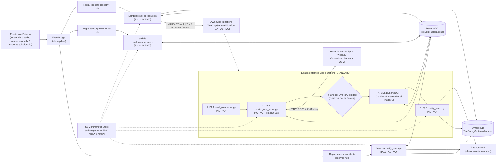

# Módulo de Orquestación y Reglas de Negocio (`orquestacion/` — P2)

Implementa el enrutamiento de eventos en **Amazon EventBridge**, la detección colectiva deduplicada en ventanas menores a $24\text{ h}$, el análisis de recurrencia estructural, la priorización multi-cloud con **Azure Container Apps** (`POST /ia/analizar`), la orquestación de respuesta mediante **AWS Step Functions** y el sistema de notificaciones omnicanal sobre **Amazon SNS**.

## 1. Arquitectura del Módulo P2



## 2. Estructura de Carpeta (`orquestacion/`)

```text
orquestacion/
├── README.md                    # Documentación específica del módulo P2 (100% Completado)
├── eventbridge_rules.json       # Patrones de enrutamiento de telecorp-bus (ACTIVO - P2.1 / P2.2 / P2.5)
├── state_machine.asl.json       # Definición ASL de AWS Step Functions (ACTIVO - P2.4)
└── lambdas/
    ├── eval_collective.py       # Motor de detección colectiva < 24h (ACTIVO - P2.1)
    ├── eval_recurrence.py       # Detección de fallas estructurales multi-día (ACTIVO - P2.2)
    ├── enrich_and_score.py      # Puente Multi-Cloud Azure /ia/analizar y score (ACTIVO - P2.3)
    └── notify_users.py          # Envío de alertas omnicanal vía Amazon SNS por hito (ACTIVO - P2.5)
```

## 3. Dependencias Mínimas para P2.1 – P2.5

Antes de desplegar los recursos del módulo P2, deben existir en `us-east-1` (cuenta `390577088044`, creados en Fase 0 / P1.1):

* **Rol IAM:** `LabRole` (`arn:aws:iam::390577088044:role/LabRole`) con permisos para Lambda, DynamoDB, SSM Parameter Store, Amazon SNS y AWS Step Functions.
* **Bus EventBridge:** `telecorp-bus`
* **Tablas DynamoDB:** `TeleCorp_VentanasZonales` (TTL: `expires_at`) y `TeleCorp_Operaciones` (GSI: `GSI1_ZonaEstado`)
* **Tópico Amazon SNS:** `telecorp-alertas-zonales` con suscripciones `email` confirmadas para los integrantes del equipo (envía desde `no-reply@sns.amazonaws.com`).
* **Parámetros SSM (`SecureString` — los nombres con `/telecorp/gcp/*` se conservan por compatibilidad):**
  * `/telecorp/thresholds/collective_users` $\rightarrow$ `"10"`
  * `/telecorp/thresholds/window_hours` $\rightarrow$ `"24"`
  * `/telecorp/thresholds/recurrence_days` $\rightarrow$ `"3"`
  * `/telecorp/gcp/endpoint_url` $\rightarrow$ `"https://telecorp-ia.ambitiouspebble-a4a0a323.westus2.azurecontainerapps.io"`
  * `/telecorp/gcp/api_key` $\rightarrow$ `"5dff4dad49d1ed2c8d0bc9dc9fbf4cb3ffbb300531108ca6"`
  * `/telecorp/sns/topic_arn` $\rightarrow$ ARN del tópico `telecorp-alertas-zonales` (`arn:aws:sns:us-east-1:390577088044:telecorp-alertas-zonales`)

## 4. Etapa Implementada: Detección Colectiva (`Tarea P2.1`)

### Reglas de Negocio (`lambdas/eval_collective.py`)

1. **Deduplicación estricta ($< 24\text{ h}$):** Inserta `PK=WIN#<geohash>`, `SK=USER#<user_id>` con `ConditionExpression="attribute_not_exists(PK) OR expires_at <= :now"`. Reportes repetidos del mismo usuario en menos de $24\text{ h}$ no incrementan el contador.
2. **Contador atómico zonal:** Ante un usuario nuevo en la ventana vigente, ejecuta `ADD unique_users_count :inc` sobre `SK=COUNTER` (reiniciando atómicamente la ventana si `expires_at <= now`).
3. **Condiciones de disparo hacia Step Functions:**
   * **`COLECTIVO_10`:** `unique_users_count` alcanza el umbral de SSM ($10$).
   * **`TEMPRANO_IA`:** `unique_users_count` $\ge 3$ **y** existe una antena en el mismo `geohash` con estado `CAIDA`, `SATURADA` o `INHABILITADA` (consultada vía `GSI1_ZonaEstado`).
4. **Vinculación automática:** Reserva atómicamente `active_incident_id` para evitar disparos duplicados durante tormentas y asocia `master_incident_id` + `updated_at` en los tickets de la zona.

### Despliegue AWS CLI

```bash
export AWS_PAGER=""
export AWS_DEFAULT_REGION=us-east-1
export LAB_ROLE_ARN=$(aws iam get-role --role-name LabRole --query 'Role.Arn' --output text)

# 1. Empaquetar y desplegar Lambda
cd orquestacion/lambdas
zip eval_collective.zip eval_collective.py

aws lambda create-function \
  --function-name telecorp-eval-collective \
  --runtime python3.11 \
  --role "$LAB_ROLE_ARN" \
  --handler eval_collective.lambda_handler \
  --zip-file fileb://eval_collective.zip \
  --timeout 15 \
  --memory-size 256 \
  --environment "Variables={TABLA_OPERACIONES=TeleCorp_Operaciones,TABLA_VENTANAS=TeleCorp_VentanasZonales,STATE_MACHINE_NAME=TeleCorpSentinelWorkflow}"

# 2. Crear regla en telecorp-bus y vincular Lambda
export LAMBDA_ARN=$(aws lambda get-function --function-name telecorp-eval-collective --query 'Configuration.FunctionArn' --output text)

aws events put-rule \
  --name telecorp-collective-rule \
  --event-bus-name telecorp-bus \
  --state ENABLED \
  --event-pattern '{
    "source": ["telecorp.ingesta", "telecorp.telemetria"],
    "detail-type": ["incidencia.creada", "antena.anomalia"]
  }'

aws lambda add-permission \
  --function-name telecorp-eval-collective \
  --statement-id AllowEventBridgeTeleCorpBus \
  --action lambda:InvokeFunction \
  --principal events.amazonaws.com \
  --source-arn $(aws events describe-rule --name telecorp-collective-rule --event-bus-name telecorp-bus --query 'Arn' --output text)

aws events put-targets \
  --rule telecorp-collective-rule \
  --event-bus-name telecorp-bus \
  --targets "Id=1,Arn=$LAMBDA_ARN"
```

### Validación (Definition of Done)

```bash
# 1. Enviar 10 reportes del MISMO user_id -> unique_users_count debe quedar en 1 (sin disparar Step Functions)
for i in {1..10}; do
  aws events put-events --entries "[{\"EventBusName\":\"telecorp-bus\",\"Source\":\"telecorp.ingesta\",\"DetailType\":\"incidencia.creada\",\"Detail\":\"{\\\"ticket_id\\\":\\\"TCK-DUP-$i\\\",\\\"user_id\\\":\\\"DNI-REPETIDO\\\",\\\"geohash\\\":\\\"6mc5test\\\",\\\"lat\\\":-12.0464,\\\"lon\\\":-77.0428,\\\"problem_type\\\":\\\"SIN_INTERNET\\\",\\\"description\\\":\\\"Prueba duplicada $i\\\"}\"}]" > /dev/null
done
aws dynamodb get-item --table-name TeleCorp_VentanasZonales --key '{"PK":{"S":"WIN#6mc5test"},"SK":{"S":"COUNTER"}}'

# 2. Completar 10 user_id DISTINTOS -> unique_users_count = 10 y reserva active_incident_id
for u in {2..10}; do
  aws events put-events --entries "[{\"EventBusName\":\"telecorp-bus\",\"Source\":\"telecorp.ingesta\",\"DetailType\":\"incidencia.creada\",\"Detail\":\"{\\\"ticket_id\\\":\\\"TCK-UNIQ-$u\\\",\\\"user_id\\\":\\\"DNI-UNICO-$u\\\",\\\"geohash\\\":\\\"6mc5test\\\",\\\"lat\\\":-12.0464,\\\"lon\\\":-77.0428,\\\"problem_type\\\":\\\"SIN_INTERNET\\\",\\\"description\\\":\\\"Corte en zona $u\\\"}\"}]" > /dev/null
done
aws dynamodb get-item --table-name TeleCorp_VentanasZonales --key '{"PK":{"S":"WIN#6mc5test"},"SK":{"S":"COUNTER"}}'
```

## 5. Etapa Implementada: Motor de Recurrencia Estructural (`Tarea P2.2`)

### Reglas de Negocio (`lambdas/eval_recurrence.py`)

1. **Ventana móvil multi-día ($7\text{ días}$):** Consulta en `TeleCorp_Operaciones` los eventos históricos `PK=ANTENNA#<id>`, `SK=EVENT#<YYYY-MM-DD>#<iso_ts>` dentro de los últimos $7\text{ días}$ calendario (`RECURRENCE_LOOKBACK_DAYS=7`).
2. **Conteo de días distintos con recuperación aparente:** Filtra registros anómalos (`CAIDA` $< 60\text{ GB/min}$, `SATURADA` $> 129\text{ GB/min}$, `INHABILITADA` $= 0\text{ GB/min}$), contabiliza **días calendario únicos (`YYYY-MM-DD`)** y detecta ciclos de recuperación intermedia (`recovered_at` o fallas en días previos distintos). Incluye salvaguarda ante condiciones de carrera si el evento `antena.anomalia` aún no terminó de escribir su `EVENT#` del día.
3. **Marcado de riesgo estructural (`structural_risk`):** Si `distinct_failure_days_count >= 3` (leído desde SSM `/telecorp/thresholds/recurrence_days` con caché en memoria de $60\text{ s}$), actualiza `structural_risk = true`, `recurrence_days_count` y `recent_failure_days` en `PK=ANTENNA#<id>`, `SK=CURRENT`.
4. **Doble invocación y descubrimiento zonal por `geohash`:** Soporta tanto payloads directos desde **AWS Step Functions** como eventos `antena.anomalia` desde **EventBridge** (`event["detail"]`). Si el incidente nace solo de reportes ciudadanos sin `antenna_id`, consulta `GSI1_ZonaEstado` (`GSI1PK=ZONA#<geohash>`) y selecciona la antena de mayor riesgo.

### Despliegue AWS CLI

```bash
export AWS_PAGER=""
export AWS_DEFAULT_REGION=us-east-1
export LAB_ROLE_ARN=$(aws iam get-role --role-name LabRole --query 'Role.Arn' --output text)

# 1. Empaquetar y desplegar Lambda eval_recurrence
cd orquestacion/lambdas
zip eval_recurrence.zip eval_recurrence.py

aws lambda create-function \
  --function-name telecorp-eval-recurrence \
  --runtime python3.11 \
  --role "$LAB_ROLE_ARN" \
  --handler eval_recurrence.lambda_handler \
  --zip-file fileb://eval_recurrence.zip \
  --timeout 15 \
  --memory-size 256 \
  --environment "Variables={TABLA_OPERACIONES=TeleCorp_Operaciones,SSM_RECURRENCE_DAYS_PARAM=/telecorp/thresholds/recurrence_days,RECURRENCE_LOOKBACK_DAYS=7}"

# 2. Suscribir regla de EventBridge para antena.anomalia
export REC_LAMBDA_ARN=$(aws lambda get-function --function-name telecorp-eval-recurrence --query 'Configuration.FunctionArn' --output text)

aws events put-rule \
  --name telecorp-recurrence-rule \
  --event-bus-name telecorp-bus \
  --state ENABLED \
  --event-pattern '{
    "source": ["telecorp.telemetria"],
    "detail-type": ["antena.anomalia"]
  }'

aws lambda add-permission \
  --function-name telecorp-eval-recurrence \
  --statement-id AllowEventBridgeRecurrenceRule \
  --action lambda:InvokeFunction \
  --principal events.amazonaws.com \
  --source-arn $(aws events describe-rule --name telecorp-recurrence-rule --event-bus-name telecorp-bus --query 'Arn' --output text)

aws events put-targets \
  --rule telecorp-recurrence-rule \
  --event-bus-name telecorp-bus \
  --targets "Id=1,Arn=$REC_LAMBDA_ARN"
```

### Validación (Definition of Done)

```bash
# 1. Sembrar estado CURRENT y 3 eventos históricos en días distintos (2026-11-10, 2026-11-12, 2026-11-14)
aws dynamodb put-item --table-name TeleCorp_Operaciones --item '{
  "PK": {"S": "ANTENNA#ANT-REC-09"},
  "SK": {"S": "CURRENT"},
  "GSI1PK": {"S": "ZONA#6mc5p8"},
  "GSI1SK": {"S": "ANTENNA#ANT-REC-09"},
  "antenna_id": {"S": "ANT-REC-09"},
  "zone_name": {"S": "Cercado Centro"},
  "geohash": {"S": "6mc5p8"},
  "last_traffic_gb": {"N": "41.2"},
  "health_status": {"S": "CAIDA"},
  "structural_risk": {"BOOL": false}
}'

for FECHA in 2026-11-10 2026-11-12 2026-11-14; do
  aws dynamodb put-item --table-name TeleCorp_Operaciones --item "{
    \"PK\": {\"S\": \"ANTENNA#ANT-REC-09\"},
    \"SK\": {\"S\": \"EVENT#${FECHA}#${FECHA}T10:15:00Z\"},
    \"GSI1PK\": {\"S\": \"FAILURES#ALL\"},
    \"GSI1SK\": {\"S\": \"TS#${FECHA}T10:15:00Z\"},
    \"antenna_id\": {\"S\": \"ANT-REC-09\"},
    \"date_day\": {\"S\": \"${FECHA}\"},
    \"health_status\": {\"S\": \"CAIDA\"},
    \"traffic_gb\": {\"N\": \"41.2\"},
    \"recovered_at\": {\"S\": \"${FECHA}T10:45:00Z\"},
    \"duration_sec\": {\"N\": \"1800\"}
  }"
done

# 2. Invocar Lambda simulando el payload que recibirá desde Step Functions
aws lambda invoke \
  --function-name telecorp-eval-recurrence \
  --cli-binary-format raw-in-base64-out \
  --payload '{
    "incident_id": "INC-TEST-REC-01",
    "geohash": "6mc5p8",
    "lat": -12.0464,
    "lon": -77.0428,
    "unique_users_count": 10,
    "descriptions": ["Internet caído nuevamente en Cercado"],
    "timestamp": "2026-11-14T11:00:00Z"
  }' \
  response_p2_2.json

cat response_p2_2.json
# Resultado esperado: "structural_risk": true, "distinct_failure_days_count": 3,
# "recent_failure_days": ["2026-11-10", "2026-11-12", "2026-11-14"]
```

## 6. Etapa Implementada: Puente Multi-Cloud AWS $\rightarrow$ Azure Container Apps y Priorización (`Tarea P2.3`)

### Reglas de Negocio (`lambdas/enrich_and_score.py`)

1. **Puente Multi-Cloud AWS $\rightarrow$ Azure Container Apps con Caché SSM:** Lee `/telecorp/gcp/endpoint_url` (`https://telecorp-ia.ambitiouspebble-a4a0a323.westus2.azurecontainerapps.io`) y `/telecorp/gcp/api_key` (`SecureString`) desde SSM Parameter Store con caché en memoria de $60\text{ s}$ y normaliza automáticamente el sufijo `/ia/analizar`. Invoca `POST {endpoint_url}/ia/analizar` en **Azure Container Apps** mediante `urllib.request` con cabeceras `Content-Type: application/json` y `X-API-Key`, usando `timeout=8.0s` con $1$ reintento (y *timeout* de Lambda configurado en $30\text{ s}$ para tolerar el *cold start* del contenedor).
2. **Tolerancia a Fallos (`FALLBACK_LOCAL`):** Si el servicio remoto en Azure no responde tras el reintento o sufre latencia extrema, ejecuta un motor heurístico local determinista (detección contextual de hospitales/escuelas/industrias y clasificación semántica base) para evitar que AWS Step Functions se interrumpa.
3. **Cálculo de Prioridad Operativa (`priority_score`):** Aplica la fórmula unificada de criticidad:
   $$\text{Score} = (\text{Usuarios\_Afectados} \times 10) \times \text{Multiplicador\_Zona\_Crítica} + \text{Bonus\_Antena} + \text{Bonus\_Recurrencia}$$
   * $\text{Bonus\_Antena}$: $+40\text{ pts}$ si está `CAIDA` ($< 60\text{ GB/min}$) o `INHABILITADA` ($= 0\text{ GB/min}$), $+25\text{ pts}$ si está `SATURADA` ($> 129\text{ GB/min}$), y $0\text{ pts}$ si está `NORMAL`.
   * $\text{Bonus\_Recurrencia}$: $+35\text{ pts}$ si existe alerta estructural recurrente ($\ge 3$ días distintos).
   * **Niveles:** `CRITICA` ($\ge 150$), `ALTA` ($\ge 80$), `MEDIA` ($\ge 40$) o `BAJA` ($< 40$).
4. **Persistencia de Incidente Maestro y Propagación a Tickets:** Ejecuta `UpdateItem` en `PK=INCIDENT#<incident_id>`, `SK=META` con `GSI1PK="ACTIVE#true"` y `GSI1SK="SCORE#<00000>"` (preservando `affected_users_count` mediante `if_not_exists` ante tormentas concurrentes) y propaga `ai_category`, `priority_score` y `priority_level` a los tickets vinculados.

### Despliegue AWS CLI

```bash
export AWS_PAGER=""
export AWS_DEFAULT_REGION=us-east-1
export LAB_ROLE_ARN=$(aws iam get-role --role-name LabRole --query 'Role.Arn' --output text)

# 1. Empaquetar y desplegar Lambda enrich_and_score (timeout 30s para Azure cold start + reintento)
cd orquestacion/lambdas
zip enrich_and_score.zip enrich_and_score.py

aws lambda create-function \
  --function-name telecorp-enrich-and-score \
  --runtime python3.11 \
  --role "$LAB_ROLE_ARN" \
  --handler enrich_and_score.lambda_handler \
  --zip-file fileb://enrich_and_score.zip \
  --timeout 30 \
  --memory-size 256 \
  --environment "Variables={TABLA_OPERACIONES=TeleCorp_Operaciones,SSM_GCP_URL_PARAM=/telecorp/gcp/endpoint_url,SSM_GCP_KEY_PARAM=/telecorp/gcp/api_key,GCP_TIMEOUT_SEC=8.0}"
```

### Validación (Definition of Done)

```bash
# 1. Invocar Lambda simulando incidente frente al Hospital Loayza con antena caída y recurrente
aws lambda invoke \
  --function-name telecorp-enrich-and-score \
  --cli-binary-format raw-in-base64-out \
  --payload '{
    "incident_id": "INC-TEST-P23-01",
    "geohash": "6mc5p8",
    "lat": -12.0464,
    "lon": -77.0428,
    "trigger_type": "COLECTIVO_10",
    "unique_users_count": 15,
    "descriptions": [
      "[SIN_INTERNET] Sin señal frente al Hospital Loayza",
      "[SIN_INTERNET] Internet caído en Av Alfonso Ugarte"
    ],
    "antenna_id": "ANT-LIM-042",
    "antenna_status": "CAIDA",
    "antenna_traffic_gb": 42.5,
    "structural_risk": true,
    "recent_failure_days": ["2026-11-10", "2026-11-12", "2026-11-14"]
  }' \
  response_p2_3.json

cat response_p2_3.json
# Resultado esperado: "priority_score": 525.0, "priority_level": "CRITICA",
# "structural_recurrence_alert": true

# 2. Verificar persistencia del Incidente Maestro en DynamoDB
aws dynamodb get-item \
  --table-name TeleCorp_Operaciones \
  --key '{"PK":{"S":"INCIDENT#INC-TEST-P23-01"},"SK":{"S":"META"}}'
```

## 7. Etapa Implementada: Máquina de Estados AWS Step Functions (`Tarea P2.4`)

### Reglas de Negocio y Flujo de Estados (`state_machine.asl.json`)

1. **Orquestación Visual `STANDARD` (`TeleCorpSentinelWorkflow`):** Ejecuta de extremo a extremo la cadena de correlación y respuesta automatizada sin intervención manual, permitiendo auditar cada transición en tiempo real desde la consola de AWS Step Functions.
2. **Correlación y Enriquecimiento Multi-Cloud:**
   * `VerificarInfraestructuraYRecurrencia`: Invoca `telecorp-eval-recurrence` (P2.2) con reintentos exponenciales (`MaxAttempts: 3`) y bloque `Catch` hacia `FallbackRecurrencia`.
   * `AnalizarConIAYGeoespacialGCP`: Envía el contexto zonal y el historial de fallas de antena hacia `telecorp-enrich-and-score` (P2.3) para consultar **Azure Container Apps** (`/ia/analizar`: Gemini + OpenStreetMap Overpass), con respaldo `FallbackPriorizacionLocal` en caso de latencia extrema.
3. **Enrutamiento Inteligente por Criticidad (`EvaluarCriticidad` — `Choice`):**
   * **`CRITICA` ($\ge 150\text{ pts}$):** Despacha sin demora ($0\text{ s}$) a `PrepararAtencionInmediata` asignando `status = "Siendo atendida"` y `dispatch_mode = "INMEDIATO_CRITICO"`.
   * **`ALTA`, `MEDIA` o Detección Temprana IA (`early_anomaly_detected == true`):** Enruta inmediatamente a `PrepararRevisionPrioritaria` asignando `status = "En revisión"` y `dispatch_mode = "ESTANDAR_PRIORIZADO"`.
   * **`BAJA` ($< 40\text{ pts}$):** Pasa por una ventana breve de confirmación (`EsperarConfirmacionPersistencia` de $15\text{ s}$) antes de escalar a revisión.
4. **Confirmación Nativa en DynamoDB (`ConfirmarIncidenteZonal`):** Utiliza integración directa AWS SDK (`arn:aws:states:::dynamodb:updateItem`) para actualizar `status`, `dispatch_mode`, `confirmed_at` y `workflow_execution_id` en `PK=INCIDENT#<incident_id>`, `SK=META` sin incurrir en costos de una función Lambda intermedia.
5. **Disparo de Notificaciones Omnicanal (`NotificarUsuariosAfectados`):** Invoca `telecorp-notify-users` (P2.5) enviando el hito `INCIDENCIA_IDENTIFICADA` (o `EN_EVALUACION`) junto con el diagnóstico IA y puntos críticos cercanos para su difusión vía **Amazon SNS** (`no-reply@sns.amazonaws.com`), contando con `FallbackNotificacionDegradada` para garantizar que la máquina finalice siempre en `SUCCEEDED`.

### Despliegue AWS CLI

```bash
export AWS_PAGER=""
export AWS_DEFAULT_REGION=us-east-1
export ACCOUNT_ID=$(aws sts get-caller-identity --query 'Account' --output text)
export LAB_ROLE_ARN=$(aws iam get-role --role-name LabRole --query 'Role.Arn' --output text)

# 1. Inyectar ACCOUNT_ID en la definición ASL
cd orquestacion
sed "s/\${ACCOUNT_ID}/$ACCOUNT_ID/g" state_machine.asl.json > state_machine.rendered.json

# 2. Crear la máquina de estados STANDARD
aws stepfunctions create-state-machine \
  --name TeleCorpSentinelWorkflow \
  --definition file://state_machine.rendered.json \
  --role-arn "$LAB_ROLE_ARN" \
  --type STANDARD

# (Si ya existe y deseas actualizarla tras editar state_machine.asl.json:)
# export SM_ARN="arn:aws:states:us-east-1:${ACCOUNT_ID}:stateMachine:TeleCorpSentinelWorkflow"
# aws stepfunctions update-state-machine \
#   --state-machine-arn "$SM_ARN" \
#   --definition file://state_machine.rendered.json \
#   --role-arn "$LAB_ROLE_ARN"
```

### Validación (Definition of Done)

```bash
export SM_ARN="arn:aws:states:us-east-1:${ACCOUNT_ID}:stateMachine:TeleCorpSentinelWorkflow"

# 1. Iniciar ejecución simulando incidente colectivo en zona hospitalaria (6mc5p8)
EXEC_ARN=$(aws stepfunctions start-execution \
  --state-machine-arn "$SM_ARN" \
  --name "test-p24-hospital-$(date +%s)" \
  --input '{
    "incident_id": "INC-TEST-P24-01",
    "geohash": "6mc5p8",
    "lat": -12.0464,
    "lon": -77.0428,
    "trigger_type": "COLECTIVO_10",
    "unique_users_count": 12,
    "descriptions": [
      "[SIN_INTERNET] Sin señal frente al Hospital Loayza",
      "[SIN_INTERNET] Internet caído en Av Alfonso Ugarte"
    ],
    "timestamp": "2026-11-14T16:12:00Z"
  }' \
  --query 'executionArn' --output text)

echo "Ejecución iniciada: $EXEC_ARN"
sleep 6

# 2. Verificar que status == SUCCEEDED y revisar el resultado consolidado
aws stepfunctions describe-execution \
  --execution-arn "$EXEC_ARN" \
  --query '{Status: status, StartDate: startDate, StopDate: stopDate, Output: output}'

# 3. Verificar que ConfirmarIncidenteZonal actualizó status y workflow_execution_id en DynamoDB
aws dynamodb get-item \
  --table-name TeleCorp_Operaciones \
  --key '{"PK":{"S":"INCIDENT#INC-TEST-P24-01"},"SK":{"S":"META"}}'
```

## 8. Etapa Implementada: Sistema de Notificaciones Omnicanal (`Tarea P2.5`)

### Reglas de Negocio (`lambdas/notify_users.py`)

1. **Cobertura de los 3 Hitos Operativos:** Adapta dinámicamente el asunto ($\le 95$ caracteres), el cuerpo de correo y el mensaje SMS ($\le 160$ caracteres) según el estado del incidente:
   * **`EN_EVALUACION`** (`status == "En revisión"`): Informa al usuario que su reporte está siendo correlacionado con la telemetría de red.
   * **`INCIDENCIA_IDENTIFICADA`** (`status == "Siendo atendida"`): Confirma afectación colectiva/zonal, nivel de prioridad, puntos críticos cercanos y diagnóstico IA.
   * **`SERVICIO_RESTABLECIDO`** (`status == "Solucionada"` o evento `incidente.solucionado` vía EventBridge): Confirma la normalización del servicio y la acción técnica ejecutada.
2. **Difusión Consolidada por Amazon SNS + SSM:** Lee `/telecorp/sns/topic_arn` (`SecureString`) desde SSM Parameter Store con caché en memoria de $60\text{ s}$ y realiza **1 publicación consolidada por incidente/hito** hacia `telecorp-alertas-zonales` (remitente `no-reply@sns.amazonaws.com` con `MessageAttributes` de `geohash`, `milestone` y `priority_level`), evitando spam de correos idénticos durante tormentas de reportes.
3. **Canal SMS Resiliente para AWS Academy:** Genera la notificación breve para cada teléfono único afectado; por defecto (`ENABLE_DIRECT_SMS=false`) opera en modo seguro `SIMULATED_SMS_ACADEMY` para evitar bloqueos del Sandbox SMS en Learner Lab, soportando activación directa (`ENABLE_DIRECT_SMS=true`) con fallback automático.
4. **Cierre en Cascada al Restablecer Servicio:** Al recibir `SERVICIO_RESTABLECIDO`, actualiza de forma idempotente en `TeleCorp_Operaciones` el `IncidenteMaestro` (`status = "Solucionada"`, `GSI1PK = "ACTIVE#false"`, `closed_at`) y todos sus tickets hermanos abiertos con registro `HIST#`.
5. **Auditoría Individual Omnicanal:** Persiste en `TeleCorp_VentanasZonales` un registro por cada usuario y canal afectado (`PK=TICKET#<id>`, `SK=NOTIF#<iso_ts>#EMAIL` y `SK=NOTIF#<iso_ts>#SMS`, con `GSI1PK=INCIDENT#<incident_id>`).

### Despliegue AWS CLI

```bash
export AWS_PAGER=""
export AWS_DEFAULT_REGION=us-east-1
export LAB_ROLE_ARN=$(aws iam get-role --role-name LabRole --query 'Role.Arn' --output text)

# 1. Crear tópico SNS y suscribir correos reales del equipo (confirmar enlace en bandeja)
export SNS_TOPIC_ARN=$(aws sns create-topic --name telecorp-alertas-zonales --query 'TopicArn' --output text)

aws sns subscribe --topic-arn "$SNS_TOPIC_ARN" --protocol email --notification-endpoint "correo_p1@dominio.com"
aws sns subscribe --topic-arn "$SNS_TOPIC_ARN" --protocol email --notification-endpoint "correo_p2@dominio.com"
aws sns subscribe --topic-arn "$SNS_TOPIC_ARN" --protocol email --notification-endpoint "correo_p3@dominio.com"

aws ssm put-parameter \
  --name "/telecorp/sns/topic_arn" \
  --value "$SNS_TOPIC_ARN" \
  --type "SecureString" \
  --overwrite

# 2. Empaquetar y desplegar Lambda notify_users
cd orquestacion/lambdas
zip notify_users.zip notify_users.py

aws lambda create-function \
  --function-name telecorp-notify-users \
  --runtime python3.11 \
  --role "$LAB_ROLE_ARN" \
  --handler notify_users.lambda_handler \
  --zip-file fileb://notify_users.zip \
  --timeout 15 \
  --memory-size 256 \
  --environment "Variables={TABLA_OPERACIONES=TeleCorp_Operaciones,TABLA_VENTANAS=TeleCorp_VentanasZonales,SSM_SNS_TOPIC_PARAM=/telecorp/sns/topic_arn,ENABLE_DIRECT_SMS=false}"

# 3. Suscribir regla de EventBridge para incidente.solucionado (SERVICIO_RESTABLECIDO)
export NOTIFY_LAMBDA_ARN=$(aws lambda get-function --function-name telecorp-notify-users --query 'Configuration.FunctionArn' --output text)

aws events put-rule \
  --name telecorp-incident-resolved-rule \
  --event-bus-name telecorp-bus \
  --state ENABLED \
  --event-pattern '{
    "source": ["telecorp.operaciones"],
    "detail-type": ["incidente.solucionado"]
  }'

aws lambda add-permission \
  --function-name telecorp-notify-users \
  --statement-id AllowEventBridgeResolvedRule \
  --action lambda:InvokeFunction \
  --principal events.amazonaws.com \
  --source-arn $(aws events describe-rule --name telecorp-incident-resolved-rule --event-bus-name telecorp-bus --query 'Arn' --output text)

aws events put-targets \
  --rule telecorp-incident-resolved-rule \
  --event-bus-name telecorp-bus \
  --targets "Id=1,Arn=$NOTIFY_LAMBDA_ARN"
```

### Validación (Definition of Done)

```bash
# 1. Sembrar ticket de prueba vinculado a INC-TEST-P24-01
aws dynamodb put-item --table-name TeleCorp_Operaciones --item '{
  "PK": {"S": "TICKET#TCK-TEST-P25"},
  "SK": {"S": "META"},
  "GSI1PK": {"S": "ZONA#6mc5p8"},
  "GSI1SK": {"S": "TS#2026-11-14T16:10:00Z"},
  "ticket_id": {"S": "TCK-TEST-P25"},
  "user_id": {"S": "DNI-70451289"},
  "service_number": {"S": "999111222"},
  "email": {"S": "correo_p2@dominio.com"},
  "phone": {"S": "+51999111222"},
  "geohash": {"S": "6mc5p8"},
  "status": {"S": "Siendo atendida"},
  "master_incident_id": {"S": "INC-TEST-P24-01"}
}'

# 2. Probar Hito 2: INCIDENCIA_IDENTIFICADA (invocación equivalente desde Step Functions)
aws lambda invoke \
  --function-name telecorp-notify-users \
  --cli-binary-format raw-in-base64-out \
  --payload '{
    "incident_id": "INC-TEST-P24-01",
    "geohash": "6mc5p8",
    "zone_name": "Cercado Centro - Hospital Loayza",
    "milestone": "INCIDENCIA_IDENTIFICADA",
    "priority_level": "CRITICA",
    "ai_diagnosis": "Corte de enlace en ANT-LIM-042 afectando entorno hospitalario.",
    "critical_pois": [{"name": "Hospital Nacional Arzobispo Loayza", "type": "hospital", "distance_m": 180}]
  }' \
  response_p2_5_identificada.json

cat response_p2_5_identificada.json
# Resultado esperado: "status": "NOTIFIED", "email_delivery_status": "SENT_SNS", "audit_records_written": 2

# 3. Probar Hito 3: SERVICIO_RESTABLECIDO vía evento incidente.solucionado en EventBridge
aws events put-events --entries '[{
  "EventBusName": "telecorp-bus",
  "Source": "telecorp.operaciones",
  "DetailType": "incidente.solucionado",
  "Detail": "{\"incident_id\":\"INC-TEST-P24-01\",\"ticket_id\":\"TCK-TEST-P25\",\"geohash\":\"6mc5p8\",\"new_status\":\"Solucionada\",\"changed_by\":\"OPERADOR\",\"note\":\"Enlace de fibra restablecido en ANT-LIM-042\",\"timestamp\":\"2026-11-14T17:05:00Z\"}"
}]'

sleep 3

# 4. Verificar registros de auditoría EMAIL y SMS en TeleCorp_VentanasZonales
aws dynamodb query \
  --table-name TeleCorp_VentanasZonales \
  --key-condition-expression "PK = :pk AND begins_with(SK, :sk)" \
  --expression-attribute-values '{":pk":{"S":"TICKET#TCK-TEST-P25"},":sk":{"S":"NOTIF#"}}'
```

## 9. Progreso del Módulo P2

| Tarea | Archivo / Recurso | Estado |
| :--- | :--- | :--- |
| **P2.1** — Reglas EventBridge + Detección Colectiva | `eventbridge_rules.json` + `eval_collective.py` | **Completado** |
| **P2.2** — Motor de Recurrencia Estructural | `eventbridge_rules.json` + `eval_recurrence.py` | **Completado** |
| **P2.3** — Puente Multi-Cloud AWS $\rightarrow$ Azure + Score | `lambdas/enrich_and_score.py` | **Completado** |
| **P2.4** — Máquina de Estados AWS Step Functions | `state_machine.asl.json` (`TeleCorpSentinelWorkflow`) | **Completado** |
| **P2.5** — Sistema de Notificaciones Omnicanal (SNS) | `eventbridge_rules.json` + `lambdas/notify_users.py` | **Completado** |

## 10. Notas de Sincronización para P1 y P3

Los contratos congelados (`dynamodb_schemas.json`, `eventbridge_events.json`, `openapi.yaml`) **no cambian**; consideren estos puntos operativos al integrar:

* **Para P1 (Datos e Ingesta):**
  * **Control de Concurrencia ($\le 10$ Lambdas):** Mantener `MaximumConcurrency=2` y `BatchSize=10` en las 3 colas SQS, deduplicación intra-lote y espaciado de $0.25\text{ s}$ hacia EventBridge en `ingest_ticket.py` e `ingest_telemetry.py`, y *throttling* (`burstLimit=2`, `rateLimit=3`) en API Gateway.
  * **Parámetro SSM de Notificaciones:** En `setup_aws.sh`, usar `/telecorp/sns/topic_arn` (`SecureString`) apuntando al tópico `telecorp-alertas-zonales`.
  * **Geohash de precisión 6:** `ingest_ticket.py` e `ingest_telemetry.py` calculan `geohash` con exactamente **6 caracteres** para cruzar reportes con antenas.
  * **Índice `GSI1_ZonaEstado` e Historial `EVENT#`:** Al guardar `ANTENNA#<id>` (`SK=CURRENT`) en `TeleCorp_Operaciones`, llenar `GSI1PK="ZONA#<geohash>"` y `GSI1SK="ANTENNA#<id>"`. Ante estados anómalos (`CAIDA`, `SATURADA`, `INHABILITADA`), insertar `PK="ANTENNA#<id>"`, `SK="EVENT#<YYYY-MM-DD>#<iso_ts>"` con `date_day`, `health_status` y `traffic_gb`; al volver a `NORMAL` ($60\text{--}129\text{ GB/min}$), actualizar `recovered_at` y `duration_sec`.
  * **Endpoints REST completos en `api_crud.py`:** Incluye `GET /incidentes`, `PATCH /incidentes/{incident_id}/estado` (cierre en cascada), `GET /antenas` y `incident_time` en `POST/GET /tickets`, además de emitir `incidente.solucionado` (`Source: "telecorp.operaciones"`) en `telecorp-bus` al marcar `"Solucionada"`.
* **Para P3 (Frontend SPA & IA Azure Container Apps):**
  * **Microservicio IA en Azure Container Apps (`westus2`):** Activo en `https://telecorp-ia.ambitiouspebble-a4a0a323.westus2.azurecontainerapps.io` (`POST /ia/analizar` con `X-API-Key`). Los parámetros SSM `/telecorp/gcp/endpoint_url` y `/telecorp/gcp/api_key` conservan su nombre para mantener compatibilidad sin cambios de configuración.
  * **Confirmación de Suscripción SNS:** Confirmar el enlace de suscripción al tópico `telecorp-alertas-zonales` enviado desde `no-reply@sns.amazonaws.com` para recibir en vivo las alertas durante la grabación del pitch.
  * **Compilación Vite/React (`HashRouter`) para S3:** Antes de subir `frontend/dist/` a S3, generar `.env.production` con `VITE_API_BASE_URL` (sin `/` final) y `VITE_MOCK=false`, ejecutar `npm run build` y sincronizar hacia `s3://telecorp-sentinel-portal-390577088044/`.
  * **Campos, estados y auditoría en NOC y Portal:** Cada `INCIDENT#<id>` incluye `critical_pois`, `priority_score`, `priority_level`, `ai_diagnosis`, `structural_recurrence_alert`, `ai_source`, `dispatch_mode`, `workflow_execution_id` y `ticket_ids`; los tickets vinculados reciben `ai_category`, `priority_score` y `priority_level`; y la auditoría omnicanal queda en `TeleCorp_VentanasZonales` bajo `PK=TICKET#<id>`, `SK=NOTIF#<iso_ts>#<channel>` con estados `SENT_SNS` (Email) y `SIMULATED_SMS_ACADEMY` (SMS).
