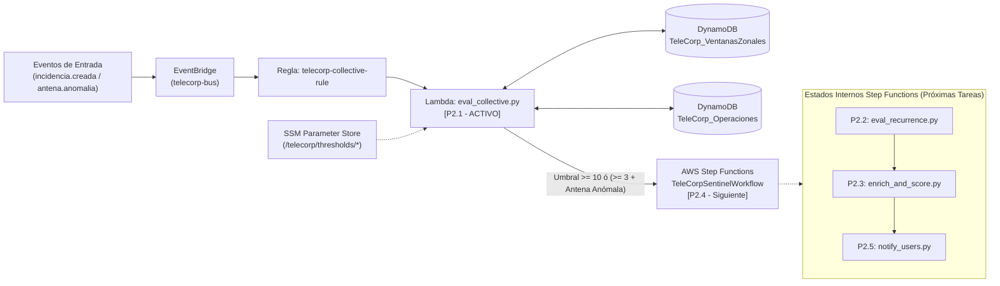

# Módulo de Orquestación y Reglas de Negocio (`orquestacion/` — P2)

Implementa el enrutamiento de eventos en **Amazon EventBridge**, la detección colectiva deduplicada en ventanas menores a $24\text{h}$, el análisis de recurrencia estructural, la priorización multi-cloud y la orquestación de respuesta mediante **AWS Step Functions**.

## 1. Arquitectura del Módulo P2



## 2. Estructura de Carpeta (`orquestacion/`)

```text
orquestacion/
├── README.md                    # Documentación específica del módulo P2
├── eventbridge_rules.json       # Patrón de enrutamiento de telecorp-bus (P2.1)
├── state_machine.asl.json       # Definición ASL de AWS Step Functions (Pendiente P2.4)
└── lambdas/
    ├── eval_collective.py       # Motor de detección colectiva < 24h (ACTIVO - P2.1)
    ├── eval_recurrence.py       # Detección de fallas estructurales multi-día (Pendiente P2.2)
    ├── enrich_and_score.py      # Integración GCP /ia/analizar y score (Pendiente P2.3)
    └── notify_users.py          # Envío de alertas SES/SNS por hito (Pendiente P2.5)
```

## 3. Dependencias Mínimas para P2.1

Antes de desplegar `eval_collective.py`, deben existir en `us-east-1` (creados en Fase 0 / P1.1):
* **Bus EventBridge:** `telecorp-bus`
* **Tablas DynamoDB:** `TeleCorp_VentanasZonales` (TTL: `expires_at`) y `TeleCorp_Operaciones` (GSI: `GSI1_ZonaEstado`)
* **Parámetros SSM (`SecureString`):**
  * `/telecorp/thresholds/collective_users` $\rightarrow$ `"10"`
  * `/telecorp/thresholds/window_hours` $\rightarrow$ `"24"`

## 4. Etapa Implementada: Detección Colectiva (`Tarea P2.1`)

### Reglas de Negocio (`lambdas/eval_collective.py`)
1. **Deduplicación estricta ($< 24\text{h}$):** Inserta `PK=WIN#<geohash>`, `SK=USER#<user_id>` con `ConditionExpression="attribute_not_exists(PK) OR expires_at <= :now"`. Reportes repetidos del mismo usuario en menos de $24\text{h}$ no incrementan el contador.
2. **Contador atómico zonal:** Ante un usuario nuevo en la ventana vigente, ejecuta `ADD unique_users_count :inc` sobre `SK=COUNTER` (reiniciando atómicamente la ventana si `expires_at <= now`).
3. **Condiciones de disparo hacia Step Functions:**
   * **`COLECTIVO_10`:** `unique_users_count` alcanza el umbral de SSM ($10$).
   * **`TEMPRANO_IA`:** `unique_users_count` $\ge 3$ **y** existe una antena en el mismo `geohash` con estado `CAIDA`, `SATURADA` o `INHABILITADA` (consultada vía `GSI1_ZonaEstado`).
4. **Vinculación automática:** Reserva atómicamente `active_incident_id` para evitar disparos duplicados durante tormentas y asocia `master_incident_id` + `updated_at` en los tickets de la zona.

### Despliegue AWS CLI

```bash
export AWS_DEFAULT_REGION=us-east-1
export LAB_ROLE_ARN=$(aws iam get-role --role-name LabRole --query 'Role.Arn' --output text)

# 1. Empaquetar y desplegar Lambda
cd orquestacion/lambdas
zip eval_collective.zip eval_collective.py

aws lambda create-function \
  --function-name telecorp-eval-collective \
  --runtime python3.11 \
  --role "$LAB_ROLE_ARN" \
  --handler eval_collective.lambda_handler \
  --zip-file fileb://eval_collective.zip \
  --timeout 15 \
  --memory-size 256 \
  --environment "Variables={TABLA_OPERACIONES=TeleCorp_Operaciones,TABLA_VENTANAS=TeleCorp_VentanasZonales,STATE_MACHINE_NAME=TeleCorpSentinelWorkflow}"

# 2. Crear regla en telecorp-bus y vincular Lambda
export LAMBDA_ARN=$(aws lambda get-function --function-name telecorp-eval-collective --query 'Configuration.FunctionArn' --output text)

aws events put-rule \
  --name telecorp-collective-rule \
  --event-bus-name telecorp-bus \
  --state ENABLED \
  --event-pattern '{
    "source": ["telecorp.ingesta", "telecorp.telemetria"],
    "detail-type": ["incidencia.creada", "antena.anomalia"]
  }'

aws lambda add-permission \
  --function-name telecorp-eval-collective \
  --statement-id AllowEventBridgeTeleCorpBus \
  --action lambda:InvokeFunction \
  --principal events.amazonaws.com \
  --source-arn $(aws events describe-rule --name telecorp-collective-rule --event-bus-name telecorp-bus --query 'Arn' --output text)

aws events put-targets \
  --rule telecorp-collective-rule \
  --event-bus-name telecorp-bus \
  --targets "Id=1,Arn=$LAMBDA_ARN"
```

### Validación (Definition of Done)

```bash
# 1. Enviar 10 reportes del MISMO user_id -> unique_users_count debe quedar en 1 (sin disparar Step Functions)
for i in {1..10}; do
  aws events put-events --entries "[{\"EventBusName\":\"telecorp-bus\",\"Source\":\"telecorp.ingesta\",\"DetailType\":\"incidencia.creada\",\"Detail\":\"{\\\"ticket_id\\\":\\\"TCK-DUP-$i\\\",\\\"user_id\\\":\\\"DNI-REPETIDO\\\",\\\"geohash\\\":\\\"6mc5test\\\",\\\"lat\\\":-12.0464,\\\"lon\\\":-77.0428,\\\"problem_type\\\":\\\"SIN_INTERNET\\\",\\\"description\\\":\\\"Prueba duplicada $i\\\"}\"}]" > /dev/null
done
aws dynamodb get-item --table-name TeleCorp_VentanasZonales --key '{"PK":{"S":"WIN#6mc5test"},"SK":{"S":"COUNTER"}}'

# 2. Completar 10 user_id DISTINTOS -> unique_users_count = 10 y reserva active_incident_id
for u in {2..10}; do
  aws events put-events --entries "[{\"EventBusName\":\"telecorp-bus\",\"Source\":\"telecorp.ingesta\",\"DetailType\":\"incidencia.creada\",\"Detail\":\"{\\\"ticket_id\\\":\\\"TCK-UNIQ-$u\\\",\\\"user_id\\\":\\\"DNI-UNICO-$u\\\",\\\"geohash\\\":\\\"6mc5test\\\",\\\"lat\\\":-12.0464,\\\"lon\\\":-77.0428,\\\"problem_type\\\":\\\"SIN_INTERNET\\\",\\\"description\\\":\\\"Corte en zona $u\\\"}\"}]" > /dev/null
done
aws dynamodb get-item --table-name TeleCorp_VentanasZonales --key '{"PK":{"S":"WIN#6mc5test"},"SK":{"S":"COUNTER"}}'
```

## 5. Progreso del Módulo P2

| Tarea | Archivo / Recurso | Estado |
| :--- | :--- | :--- |
| **P2.1** — Reglas EventBridge + Detección Colectiva | `eventbridge_rules.json` + `eval_collective.py` | **Completado** |
| **P2.2** — Motor de Recurrencia Estructural | `lambdas/eval_recurrence.py` | Pendiente |
| **P2.3** — Puente Multi-Cloud AWS $\rightarrow$ GCP + Score | `lambdas/enrich_and_score.py` | Pendiente |
| **P2.4** — Máquina de Estados AWS Step Functions | `state_machine.asl.json` | Pendiente |
| **P2.5** — Sistema de Notificaciones Omnicanal | `lambdas/notify_users.py` | Pendiente |
