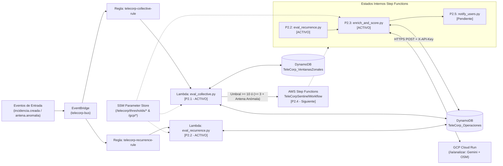

# Módulo de Orquestación y Reglas de Negocio (`orquestacion/` — P2)

Implementa el enrutamiento de eventos en **Amazon EventBridge**, la detección colectiva deduplicada en ventanas menores a $24\text{h}$, el análisis de recurrencia estructural, la priorización multi-cloud con **GCP Cloud Run** y la orquestación de respuesta mediante **AWS Step Functions**.

## 1. Arquitectura del Módulo P2



## 2. Estructura de Carpeta (`orquestacion/`)

```text
orquestacion/
├── README.md                    # Documentación específica del módulo P2
├── eventbridge_rules.json       # Patrones de enrutamiento de telecorp-bus (ACTIVO - P2.1 / P2.2)
├── state_machine.asl.json       # Definición ASL de AWS Step Functions (Siguiente P2.4)
└── lambdas/
    ├── eval_collective.py       # Motor de detección colectiva < 24h (ACTIVO - P2.1)
    ├── eval_recurrence.py       # Detección de fallas estructurales multi-día (ACTIVO - P2.2)
    ├── enrich_and_score.py      # Puente Multi-Cloud GCP /ia/analizar y score (ACTIVO - P2.3)
    └── notify_users.py          # Envío de alertas SES/SNS por hito (Pendiente P2.5)
```

## 3. Dependencias Mínimas para P2.1, P2.2 y P2.3

Antes de desplegar las Lambdas del módulo P2, deben existir en `us-east-1` (creados en Fase 0 / P1.1):

* **Bus EventBridge:** `telecorp-bus`
* **Tablas DynamoDB:** `TeleCorp_VentanasZonales` (TTL: `expires_at`) y `TeleCorp_Operaciones` (GSI: `GSI1_ZonaEstado`)
* **Parámetros SSM (`SecureString`):**
  * `/telecorp/thresholds/collective_users` $\rightarrow$ `"10"`
  * `/telecorp/thresholds/window_hours` $\rightarrow$ `"24"`
  * `/telecorp/thresholds/recurrence_days` $\rightarrow$ `"3"`
  * `/telecorp/gcp/endpoint_url` $\rightarrow$ URL de Google Cloud Run (o `"PENDIENTE_URL_CLOUD_RUN"` para operar en modo `FALLBACK_LOCAL`)
  * `/telecorp/gcp/api_key` $\rightarrow$ `"TELECORP-SECRET-KEY-2026"`

## 4. Etapa Implementada: Detección Colectiva (`Tarea P2.1`)

### Reglas de Negocio (`lambdas/eval_collective.py`)

1. **Deduplicación estricta ($< 24\text{h}$):** Inserta `PK=WIN#<geohash>`, `SK=USER#<user_id>` con `ConditionExpression="attribute_not_exists(PK) OR expires_at <= :now"`. Reportes repetidos del mismo usuario en menos de $24\text{h}$ no incrementan el contador.
2. **Contador atómico zonal:** Ante un usuario nuevo en la ventana vigente, ejecuta `ADD unique_users_count :inc` sobre `SK=COUNTER` (reiniciando atómicamente la ventana si `expires_at <= now`).
3. **Condiciones de disparo hacia Step Functions:**
   * **`COLECTIVO_10`:** `unique_users_count` alcanza el umbral de SSM ($10$).
   * **`TEMPRANO_IA`:** `unique_users_count` $\ge 3$ **y** existe una antena en el mismo `geohash` con estado `CAIDA`, `SATURADA` o `INHABILITADA` (consultada vía `GSI1_ZonaEstado`).
4. **Vinculación automática:** Reserva atómicamente `active_incident_id` para evitar disparos duplicados durante tormentas y asocia `master_incident_id` + `updated_at` en los tickets de la zona.

### Despliegue AWS CLI

```bash
export AWS_DEFAULT_REGION=us-east-1
export LAB_ROLE_ARN=$(aws iam get-role --role-name LabRole --query 'Role.Arn' --output text)

# 1. Empaquetar y desplegar Lambda
cd orquestacion/lambdas
zip eval_collective.zip eval_collective.py

aws lambda create-function \
  --function-name telecorp-eval-collective \
  --runtime python3.11 \
  --role "$LAB_ROLE_ARN" \
  --handler eval_collective.lambda_handler \
  --zip-file fileb://eval_collective.zip \
  --timeout 15 \
  --memory-size 256 \
  --environment "Variables={TABLA_OPERACIONES=TeleCorp_Operaciones,TABLA_VENTANAS=TeleCorp_VentanasZonales,STATE_MACHINE_NAME=TeleCorpSentinelWorkflow}"

# 2. Crear regla en telecorp-bus y vincular Lambda
export LAMBDA_ARN=$(aws lambda get-function --function-name telecorp-eval-collective --query 'Configuration.FunctionArn' --output text)

aws events put-rule \
  --name telecorp-collective-rule \
  --event-bus-name telecorp-bus \
  --state ENABLED \
  --event-pattern '{
    "source": ["telecorp.ingesta", "telecorp.telemetria"],
    "detail-type": ["incidencia.creada", "antena.anomalia"]
  }'

aws lambda add-permission \
  --function-name telecorp-eval-collective \
  --statement-id AllowEventBridgeTeleCorpBus \
  --action lambda:InvokeFunction \
  --principal events.amazonaws.com \
  --source-arn $(aws events describe-rule --name telecorp-collective-rule --event-bus-name telecorp-bus --query 'Arn' --output text)

aws events put-targets \
  --rule telecorp-collective-rule \
  --event-bus-name telecorp-bus \
  --targets "Id=1,Arn=$LAMBDA_ARN"
```

### Validación (Definition of Done)

```bash
# 1. Enviar 10 reportes del MISMO user_id -> unique_users_count debe quedar en 1 (sin disparar Step Functions)
for i in {1..10}; do
  aws events put-events --entries "[{\"EventBusName\":\"telecorp-bus\",\"Source\":\"telecorp.ingesta\",\"DetailType\":\"incidencia.creada\",\"Detail\":\"{\\\"ticket_id\\\":\\\"TCK-DUP-$i\\\",\\\"user_id\\\":\\\"DNI-REPETIDO\\\",\\\"geohash\\\":\\\"6mc5test\\\",\\\"lat\\\":-12.0464,\\\"lon\\\":-77.0428,\\\"problem_type\\\":\\\"SIN_INTERNET\\\",\\\"description\\\":\\\"Prueba duplicada $i\\\"}\"}]" > /dev/null
done
aws dynamodb get-item --table-name TeleCorp_VentanasZonales --key '{"PK":{"S":"WIN#6mc5test"},"SK":{"S":"COUNTER"}}'

# 2. Completar 10 user_id DISTINTOS -> unique_users_count = 10 y reserva active_incident_id
for u in {2..10}; do
  aws events put-events --entries "[{\"EventBusName\":\"telecorp-bus\",\"Source\":\"telecorp.ingesta\",\"DetailType\":\"incidencia.creada\",\"Detail\":\"{\\\"ticket_id\\\":\\\"TCK-UNIQ-$u\\\",\\\"user_id\\\":\\\"DNI-UNICO-$u\\\",\\\"geohash\\\":\\\"6mc5test\\\",\\\"lat\\\":-12.0464,\\\"lon\\\":-77.0428,\\\"problem_type\\\":\\\"SIN_INTERNET\\\",\\\"description\\\":\\\"Corte en zona $u\\\"}\"}]" > /dev/null
done
aws dynamodb get-item --table-name TeleCorp_VentanasZonales --key '{"PK":{"S":"WIN#6mc5test"},"SK":{"S":"COUNTER"}}'
```

## 5. Etapa Implementada: Motor de Recurrencia Estructural (`Tarea P2.2`)

### Reglas de Negocio (`lambdas/eval_recurrence.py`)

1. **Ventana móvil multi-día ($7\text{ días}$):** Consulta en `TeleCorp_Operaciones` los eventos históricos `PK=ANTENNA#<id>`, `SK=EVENT#<YYYY-MM-DD>#<iso_ts>` dentro de los últimos $7\text{ días}$ calendario (`RECURRENCE_LOOKBACK_DAYS=7`).
2. **Conteo de días distintos con recuperación aparente:** Filtra registros anómalos (`CAIDA` $<60\text{ GB/min}$, `SATURADA` $>129\text{ GB/min}$, `INHABILITADA` $=0\text{ GB/min}$), contabiliza **días calendario únicos (`YYYY-MM-DD`)** y detecta ciclos de recuperación intermedia (`recovered_at` o fallas en días previos distintos). Incluye salvaguarda ante condiciones de carrera si el evento `antena.anomalia` aún no terminó de escribir su `EVENT#` del día.
3. **Marcado de riesgo estructural (`structural_risk`):** Si `distinct_failure_days_count >= 3` (leído desde SSM `/telecorp/thresholds/recurrence_days` con caché en memoria de $60\text{s}$), actualiza `structural_risk = true`, `recurrence_days_count` y `recent_failure_days` en `PK=ANTENNA#<id>`, `SK=CURRENT`.
4. **Doble invocación y descubrimiento zonal por `geohash`:** Soporta tanto payloads directos desde **AWS Step Functions** como eventos `antena.anomalia` desde **EventBridge** (`event["detail"]`). Si el incidente nace solo de reportes ciudadanos sin `antenna_id`, consulta `GSI1_ZonaEstado` (`GSI1PK=ZONA#<geohash>`) y selecciona la antena de mayor riesgo.

### Despliegue AWS CLI

```bash
export AWS_DEFAULT_REGION=us-east-1
export LAB_ROLE_ARN=$(aws iam get-role --role-name LabRole --query 'Role.Arn' --output text)

# 1. Empaquetar y desplegar Lambda eval_recurrence
cd orquestacion/lambdas
zip eval_recurrence.zip eval_recurrence.py

aws lambda create-function \
  --function-name telecorp-eval-recurrence \
  --runtime python3.11 \
  --role "$LAB_ROLE_ARN" \
  --handler eval_recurrence.lambda_handler \
  --zip-file fileb://eval_recurrence.zip \
  --timeout 15 \
  --memory-size 256 \
  --environment "Variables={TABLA_OPERACIONES=TeleCorp_Operaciones,SSM_RECURRENCE_DAYS_PARAM=/telecorp/thresholds/recurrence_days,RECURRENCE_LOOKBACK_DAYS=7}"

# 2. Suscribir regla de EventBridge para antena.anomalia
export REC_LAMBDA_ARN=$(aws lambda get-function --function-name telecorp-eval-recurrence --query 'Configuration.FunctionArn' --output text)

aws events put-rule \
  --name telecorp-recurrence-rule \
  --event-bus-name telecorp-bus \
  --state ENABLED \
  --event-pattern '{
    "source": ["telecorp.telemetria"],
    "detail-type": ["antena.anomalia"]
  }'

aws lambda add-permission \
  --function-name telecorp-eval-recurrence \
  --statement-id AllowEventBridgeRecurrenceRule \
  --action lambda:InvokeFunction \
  --principal events.amazonaws.com \
  --source-arn $(aws events describe-rule --name telecorp-recurrence-rule --event-bus-name telecorp-bus --query 'Arn' --output text)

aws events put-targets \
  --rule telecorp-recurrence-rule \
  --event-bus-name telecorp-bus \
  --targets "Id=1,Arn=$REC_LAMBDA_ARN"
```

### Validación (Definition of Done)

```bash
# 1. Sembrar estado CURRENT y 3 eventos históricos en días distintos (2026-11-10, 2026-11-12, 2026-11-14)
aws dynamodb put-item --table-name TeleCorp_Operaciones --item '{
  "PK": {"S": "ANTENNA#ANT-REC-09"},
  "SK": {"S": "CURRENT"},
  "GSI1PK": {"S": "ZONA#6mc5p8"},
  "GSI1SK": {"S": "ANTENNA#ANT-REC-09"},
  "antenna_id": {"S": "ANT-REC-09"},
  "zone_name": {"S": "Cercado Centro"},
  "geohash": {"S": "6mc5p8"},
  "last_traffic_gb": {"N": "41.2"},
  "health_status": {"S": "CAIDA"},
  "structural_risk": {"BOOL": false}
}'

for FECHA in 2026-11-10 2026-11-12 2026-11-14; do
  aws dynamodb put-item --table-name TeleCorp_Operaciones --item "{
    \"PK\": {\"S\": \"ANTENNA#ANT-REC-09\"},
    \"SK\": {\"S\": \"EVENT#${FECHA}#${FECHA}T10:15:00Z\"},
    \"GSI1PK\": {\"S\": \"FAILURES#ALL\"},
    \"GSI1SK\": {\"S\": \"TS#${FECHA}T10:15:00Z\"},
    \"antenna_id\": {\"S\": \"ANT-REC-09\"},
    \"date_day\": {\"S\": \"${FECHA}\"},
    \"health_status\": {\"S\": \"CAIDA\"},
    \"traffic_gb\": {\"N\": \"41.2\"},
    \"recovered_at\": {\"S\": \"${FECHA}T10:45:00Z\"},
    \"duration_sec\": {\"N\": \"1800\"}
  }"
done

# 2. Invocar Lambda simulando el payload que recibirá desde Step Functions
aws lambda invoke \
  --function-name telecorp-eval-recurrence \
  --cli-binary-format raw-in-base64-out \
  --payload '{
    "incident_id": "INC-TEST-REC-01",
    "geohash": "6mc5p8",
    "lat": -12.0464,
    "lon": -77.0428,
    "unique_users_count": 10,
    "descriptions": ["Internet caído nuevamente en Cercado"],
    "timestamp": "2026-11-14T11:00:00Z"
  }' \
  response_p2_2.json

cat response_p2_2.json
# Resultado esperado: "structural_risk": true, "distinct_failure_days_count": 3,
# "recent_failure_days": ["2026-11-10", "2026-11-12", "2026-11-14"]
```

## 6. Etapa Implementada: Puente Multi-Cloud AWS $\rightarrow$ GCP y Priorización (`Tarea P2.3`)

### Reglas de Negocio (`lambdas/enrich_and_score.py`)

1. **Puente Multi-Cloud AWS $\rightarrow$ GCP con Caché SSM:** Lee `/telecorp/gcp/endpoint_url` y `/telecorp/gcp/api_key` (`SecureString`) desde SSM Parameter Store con caché en memoria de $60\text{s}$ y normaliza automáticamente el sufijo `/ia/analizar`. Invoca `POST /ia/analizar` en Google Cloud Run mediante `urllib.request` con cabecera `X-API-Key` y `timeout=8.0s` (sin dependencias externas para empaquetado `.zip` puro).
2. **Tolerancia a Fallos (`FALLBACK_LOCAL`):** Si GCP Cloud Run aún no está desplegado (`PENDIENTE_URL_CLOUD_RUN`) o sufre latencia, ejecuta un motor heurístico local determinista (detección contextual de hospitales/escuelas/industrias y clasificación semántica base) para evitar que AWS Step Functions se interrumpa.
3. **Cálculo de Prioridad Operativa (`priority_score`):** Aplica la fórmula unificada de criticidad:
   $$\text{Score} = (\text{Usuarios\_Afectados} \times 10) \times \text{Multiplicador\_Zona\_Crítica} + \text{Bonus\_Antena} + \text{Bonus\_Recurrencia}$$
   * $\text{Bonus\_Antena}$: $+40\text{ pts}$ si está `CAIDA` ($<60\text{ GB/min}$) o `INHABILITADA` ($0\text{ GB/min}$), $+25\text{ pts}$ si está `SATURADA` ($>129\text{ GB/min}$), y $0\text{ pts}$ si está `NORMAL`.
   * $\text{Bonus\_Recurrencia}$: $+35\text{ pts}$ si existe alerta estructural recurrente ($\ge 3$ días distintos).
   * **Niveles:** `CRITICA` ($\ge 150$), `ALTA` ($\ge 80$), `MEDIA` ($\ge 40$) o `BAJA` ($< 40$).
4. **Persistencia de Incidente Maestro y Propagación a Tickets:** Ejecuta `UpdateItem` en `PK=INCIDENT#<incident_id>`, `SK=META` con `GSI1PK="ACTIVE#true"` y `GSI1SK="SCORE#<00000>"` (preservando `affected_users_count` mediante `if_not_exists` ante tormentas concurrentes) y propaga `ai_category`, `priority_score` y `priority_level` a los tickets vinculados.

### Despliegue AWS CLI

```bash
export AWS_DEFAULT_REGION=us-east-1
export LAB_ROLE_ARN=$(aws iam get-role --role-name LabRole --query 'Role.Arn' --output text)

# 1. Empaquetar y desplegar Lambda enrich_and_score
cd orquestacion/lambdas
zip enrich_and_score.zip enrich_and_score.py

aws lambda create-function \
  --function-name telecorp-enrich-and-score \
  --runtime python3.11 \
  --role "$LAB_ROLE_ARN" \
  --handler enrich_and_score.lambda_handler \
  --zip-file fileb://enrich_and_score.zip \
  --timeout 20 \
  --memory-size 256 \
  --environment "Variables={TABLA_OPERACIONES=TeleCorp_Operaciones,SSM_GCP_URL_PARAM=/telecorp/gcp/endpoint_url,SSM_GCP_KEY_PARAM=/telecorp/gcp/api_key,GCP_TIMEOUT_SEC=8.0}"
```

### Validación (Definition of Done)

```bash
# 1. Invocar Lambda simulando incidente frente al Hospital Loayza con antena caída y recurrente
aws lambda invoke \
  --function-name telecorp-enrich-and-score \
  --cli-binary-format raw-in-base64-out \
  --payload '{
    "incident_id": "INC-TEST-P23-01",
    "geohash": "6mc5p8",
    "lat": -12.0464,
    "lon": -77.0428,
    "trigger_type": "COLECTIVO_10",
    "unique_users_count": 15,
    "descriptions": [
      "[SIN_INTERNET] Sin señal frente al Hospital Loayza",
      "[SIN_INTERNET] Internet caído en Av Alfonso Ugarte"
    ],
    "antenna_id": "ANT-LIM-042",
    "antenna_status": "CAIDA",
    "antenna_traffic_gb": 42.5,
    "structural_risk": true,
    "recent_failure_days": ["2026-11-10", "2026-11-12", "2026-11-14"]
  }' \
  response_p2_3.json

cat response_p2_3.json
# Resultado esperado: "priority_score": 525.0, "priority_level": "CRITICA",
# "structural_recurrence_alert": true

# 2. Verificar persistencia del Incidente Maestro en DynamoDB
aws dynamodb get-item \
  --table-name TeleCorp_Operaciones \
  --key '{"PK":{"S":"INCIDENT#INC-TEST-P23-01"},"SK":{"S":"META"}}'
```

## 7. Progreso del Módulo P2

| Tarea | Archivo / Recurso | Estado |
| :--- | :--- | :--- |
| **P2.1** — Reglas EventBridge + Detección Colectiva | `eventbridge_rules.json` + `eval_collective.py` | **Completado** |
| **P2.2** — Motor de Recurrencia Estructural | `eventbridge_rules.json` + `eval_recurrence.py` | **Completado** |
| **P2.3** — Puente Multi-Cloud AWS $\rightarrow$ GCP + Score | `lambdas/enrich_and_score.py` | **Completado** |
| **P2.4** — Máquina de Estados AWS Step Functions | `state_machine.asl.json` | Pendiente (Siguiente) |
| **P2.5** — Sistema de Notificaciones Omnicanal | `lambdas/notify_users.py` | Pendiente |

## 8. Notas de Sincronización para P1 y P3

Los contratos congelados (`dynamodb_schemas.json`, `eventbridge_events.json`, `openapi.yaml`) **no cambian**; solo consideren estos puntos operativos al integrar:

* **Para P1 (Datos e Ingesta):**
  * **Geohash de precisión 6:** `ingest_ticket.py` e `ingest_telemetry.py` deben calcular `geohash` con exactamente **6 caracteres** para cruzar reportes con antenas.
  * **Índice `GSI1_ZonaEstado`:** Al guardar `ANTENNA#<id>` (`SK=CURRENT`) en `TeleCorp_Operaciones`, llenar `GSI1PK="ZONA#<geohash>"` y `GSI1SK="ANTENNA#<id>"` con `health_status` válido (`NORMAL`, `CAIDA`, `SATURADA`, `INHABILITADA`).
  * **Historial de fallas de antena (`EVENT#`):** Cuando `ingest_telemetry.py` (o `storm_simulator.py --mode recurrent`) detecte un estado anómalo (`CAIDA`, `SATURADA`, `INHABILITADA`), debe insertar `PK="ANTENNA#<id>"`, `SK="EVENT#<YYYY-MM-DD>#<iso_ts>"` con `date_day`, `health_status` y `traffic_gb`; cuando la antena regrese a `NORMAL` ($60\text{–}129\text{ GB/min}$), actualizar `recovered_at` y `duration_sec`.
  * **Incidentes Maestros en `GET /analytics/resumen` y `PATCH /tickets/{ticket_id}/estado`:** `enrich_and_score.py` persiste cada incidente con `GSI1PK="ACTIVE#true"`, `GSI1SK="SCORE#<00000>"` (5 dígitos con ceros a la izquierda para ordenamiento descendente) y `status="En revisión"`. Al solucionar/cerrar un incidente, actualizar `GSI1PK="ACTIVE#false"` y `status="Solucionada"`.
  * **Bus `telecorp-bus`:** Publicar `incidencia.creada` y `antena.anomalia` con `geohash`, `lat`, `lon` y `timestamp`. No creen reglas duplicadas (`telecorp-collective-rule` y `telecorp-recurrence-rule` ya están configuradas).
* **Para P3 (Frontend & IA GCP):**
  * **Coordenadas obligatorias:** `POST /tickets` debe enviar siempre `lat` y `lon` numéricos desde el portal para calcular la zona.
  * **Configuración de URL Cloud Run en SSM:** Al desplegar el microservicio FastAPI en GCP, actualizar `/telecorp/gcp/endpoint_url` en SSM Parameter Store (con o sin `/ia/analizar`; `enrich_and_score.py` normaliza la ruta automáticamente y cambia de `FALLBACK_LOCAL` a `GCP_GEMINI_OSM` en $\le 60\text{s}$).
  * **Contexto enriquecido para Gemini:** Cada texto en `descriptions` hacia `POST /ia/analizar` llegará con el prefijo `"[TIPO_PROBLEMA] descripción"`.
  * **Contrato de recurrencia hacia `POST /ia/analizar`:** `eval_recurrence.py` entrega `antenna_id`, `antenna_traffic_gb`, `structural_risk` (`boolean`) y `recent_failure_days` (`["YYYY-MM-DD", ...]`) listos para ser enviados al endpoint de GCP.
  * **Campos disponibles para el Dashboard NOC y Portal Usuario:** Cada `INCIDENT#<id>` ya incluye `critical_pois`, `priority_score`, `priority_level`, `ai_diagnosis`, `structural_recurrence_alert` y `ai_source`, mientras que cada ticket individual vinculado recibe `ai_category`, `priority_score` y `priority_level`.
